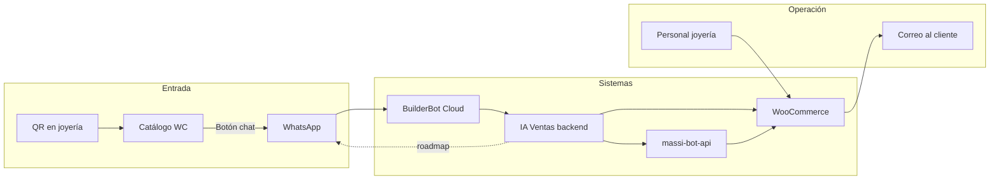
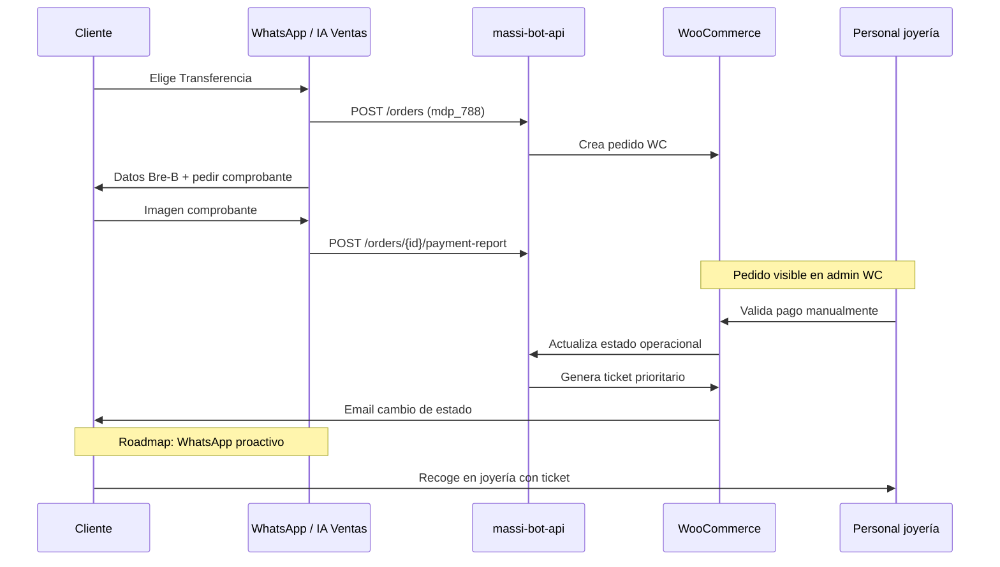

# Flujo de negocio MASSI — Contexto para agentes IA

> **Propósito:** Documentar la lógica de negocio real (joyería + WooCommerce + WhatsApp), qué hace cada sistema y qué falta implementar en **IA Ventas**.  
> **Complementa:** [`whatsapp-massi.md`](./whatsapp-massi.md) (integración técnica WhatsApp/BBC).  
> **Última actualización:** septiembre 2026 — saludo según hora + agradecimientos contextuales; coexistencia agente + turnos; ver [`docs/propuesta-mejoras-conversacion-whatsapp.md`](../../docs/propuesta-mejoras-conversacion-whatsapp.md).

---

## 1. Visión general

MASSI Joyería (tenant de referencia) vende por **dos frentes** que convergen en **WooCommerce** como sistema operativo de pedidos:

| Frente | Qué ve el cliente |
|--------|-------------------|
| **Tienda física** | QR en la joyería → catálogo web (productos) + botón para abrir **este chat de WhatsApp** |
| **Cliente remoto** | Puede estar en otra ciudad; mismo catálogo y mismo chat; la modalidad de entrega cambia (domicilio vs recoger en tienda) |

**IA Ventas** no reemplaza WooCommerce: lo **orquesta** vía REST (catálogo, pedidos MASSI, comprobantes). Los **formularios de compra** (recoger, domicilio, transferencia, efectivo, datos de envío, etc.) viven en **WordPress/WooCommerce** y en el plugin **`massi-bot-api`**. El agente WhatsApp debe converger con ese flujo, no inventar reglas paralelas.

---

## 2. Recorrido del cliente (objetivo de negocio)

### 2.1 Descubrimiento

1. Cliente escanea **QR en la joyería** (o llega por web/redes).
2. Ve el **catálogo de productos** en la tienda WooCommerce (precios, variaciones, fotos).
3. Pulsa **“Chatear / Comprar por WhatsApp”** → abre conversación con el número del negocio (BuilderBot).

> **Nota para devs:** El QR de catálogo + deep link a WhatsApp **no está en el repo IA Ventas**; es configuración del sitio WP/tema. El QR del panel `/business/whatsapp` solo vincula el **dispositivo WhatsApp del negocio** con BuilderBot.

### 2.2 Asesoría y elección de producto (WhatsApp — IA Ventas)

| Paso | Responsable | Estado en IA Ventas |
|------|-------------|---------------------|
| Saludo + perfil negocio + pedir ID | `buildWelcomeMessage` → botón catálogo WC; hora Colombia (`greeting.utils`) | ✅ Implementado |
| Agradecimiento (*gracias* solo o + instrucción) | `gratitude.utils` → respuesta por fase o venta normal | ✅ Implementado |
| Consulta catálogo (*qué productos tienen*) | Enlace `{storeUrl}/tienda/` + botón (no lista en chat) | ✅ Implementado |
| ID/SKU directo o descripción natural | RAG (`.txt`) → SKU → stock WC → carrito | ✅ Implementado |
| **Paquetes a granel (balines)** | `woo-massi` arma x10/x5/x2/x1; el agente cotiza y el checkout cobra esos paquetes | ✅ Implementado |
| Identificación por **SKU** (simple o variación) | Atajos deterministas + herramientas; multi-producto en un mensaje | ✅ Implementado |
| Carrito en sesión (`flowStep: buying` / `discovery`) | `SalesAgentService` / DynamoDB | ✅ Implementado |
| Modificar carrito (quitar/corregir/**vaciar**/ajustar qty) | Atajos deterministas; vaciar con frases naturales | ✅ Implementado |
| Cliente confirma (“finalizar con la compra”, “eso es todo”) | `finalizeCart` → **enlace formulario WC** (modo `link`, default) | ✅ Implementado |
| Cliente confirma (modo legacy) | Botones pago WhatsApp → `POST /orders` | ✅ `checkoutMode: whatsapp` |

### 2.3 Datos del pedido y modalidad (formulario WooCommerce)

Cuando el cliente **ya sabe qué comprar**, el negocio necesita capturar según el caso:

| Modalidad | Ejemplos de datos |
|-----------|-------------------|
| **Recoger en tienda** (`pickup`) | Nombre, teléfono, método de pago |
| **Domicilio** (`delivery`) | Dirección, ciudad, costo envío, contacto |
| **Transferencia** | Datos anteriores + comprobante posterior |
| **Efectivo en tienda** | Ticket provisional; pago presencial |

**Decisión de producto (jul 2026):** **Opción A — Link al formulario WC** (implementado). Opción B (captura conversacional) queda para el futuro.

| Enfoque | Ventaja | Estado |
|---------|---------|--------|
| Link formulario WC | Una sola fuente de verdad; recoger/domicilio/pago en WC | ✅ Modo `link` (default) |
| Captura por chat + API MASSI | Experiencia 100% WhatsApp | ❌ Roadmap |

**Tras “finalizar con la compra” (modo link):**

1. Valida stock del carrito WhatsApp.
2. Genera URL: `{checkoutFormUrl || checkoutPagePath || storeUrl/checkout/}?phone=…&source=whatsapp&public_store=…&items=SKU:qty,…` — paquetes woo-massi: `SKUxunidadesPorPaquete:cantidadDePaquetes` (ej. `BLL5AM005x10:1,BLL5AM005x5:1` = 15 unidades). El backend genera **`x`** (WhatsApp-safe; **no** usar `~`).
3. Envía mensaje con el enlace; vacía `cartItems` de la sesión (el pedido vive en la URL) y guarda `lastCheckoutUrl` por si pide reenviar; sesión → `flowStep: checkout_redirect`.
4. Cliente completa en WC: recoger, domicilio, transferencia, efectivo.
5. Staff valida pago en WC → ticket prioritario → email (WhatsApp proactivo: roadmap).

**Config panel** (`/business/settings`):

| Campo | Uso |
|-------|-----|
| `checkoutFormUrl` | URL absoluta del formulario MASSI/WC (opcional) |
| `checkoutPagePath` | Auto-detectada al probar WC (ej. `/finalizar-compra/`) |
| `checkoutMode` | `link` (default) \| `whatsapp` (botones legacy en chat) |

**Plugin WP:** ✅ lee `phone`, `source`, `items`, `public_store` para pre-cargar carrito (`class-massi-bot-checkout-link.php`). En balines/a granel intenta woo-massi nativo y, si falla, agrega cada paquete del link (`add_pack_line` + `wm_promo_*`). No usa solo meta `massi_bot_*` (provoca «Paquete X 0»). Requiere **MASSI Bot API ≥ 1.3.18** en producción. Parser: `x`, `~`, `%7E`, `--`.

**Setup WC:** [`woocommerce-setup-massi.md`](./woocommerce-setup-massi.md) · **BuilderBot (modo link):** misma guía §11 — sin cambios obligatorios en BBC.

### 2.4 Pago por transferencia

| Paso | Sistema | Estado IA Ventas |
|------|---------|------------------|
| Crear pedido transferencia (`mdp_788`) | MASSI API | ✅ |
| Mostrar datos bancarios | Perfil negocio `/business/settings` | ✅ |
| Recibir imagen comprobante | Webhook → `submitMassiPaymentProof` | ✅ |
| Validación humana del pago | **Panel WooCommerce** (staff) | Fuera de IA Ventas |
| Ticket prioritario para recoger | Plugin MASSI / metadatos WC `_massi_*` | Fuera de IA Ventas |
| Aviso “listo para recoger” | Email WC hoy; WhatsApp roadmap | ⚠️ Email vía WC; ❌ push WA |

### 2.5 Pago en efectivo (en tienda)

| Paso | Estado |
|------|--------|
| Botón Efectivo (`mdp_789`) → pedido + ticket provisional | ✅ |
| Cliente va a la joyería a pagar | Operación física |
| Staff confirma en WC | Fuera de IA Ventas |

### 2.6 Perfil del cliente en WooCommerce (teléfono)

Reglas de negocio descritas por el equipo:

1. Al comprar, se **crea o vincula un usuario WP/WC** usando el **número de teléfono** (WhatsApp).
2. El cliente accede a **“Mi cuenta”** en la tienda con ese teléfono.
3. En el perfil ve **histórico de compras**, estados, tickets, etc.

| Capacidad | API MASSI | Uso en agente |
|-----------|-----------|---------------|
| Buscar perfil por teléfono | `GET /massi-bot/v1/clients?phone=` | ❌ Adapter existe; agente **no lo llama** |
| Prellenar nombre/documento/ciudad | Respuesta `clients` | ❌ Roadmap |
| Historial pedidos | `GET /massi-bot/v1/orders?phone=` | ✅ Tool `consultar_pedidos` |

**Implementación del login WC con OTP:** `massi-tickets` genera el PIN; con gateway **`ia_ventas`** lo envía vía `POST /api/v1/channel/messages` (misma línea BuilderBot).

| Componente | Estado |
|------------|--------|
| Generación OTP en WP | ✅ `massi-tickets` → `OTP_Manager` |
| Envío OTP por WhatsApp (IA Ventas) | ✅ Modo **4** en MASSI → API + API Key `bb_live_…` |
| Config WP | URL `https://ventas.nedi.info/api/v1` (solo base) + key completa del panel |

---

## 3. Notificaciones de estado

| Evento | Canal hoy | Canal objetivo |
|--------|-----------|----------------|
| Cambio estado pedido WC | **Correo electrónico** (WooCommerce) | Email + **WhatsApp** |
| Pago validado → ticket prioritario | Email + metadatos MASSI | WhatsApp: “Tu pedido está listo para recoger” |
| Comprobante recibido | Mensaje fijo agente (legacy WA) | Mantener + sync con estado real |

**Implementado (jul 2026):** hook `massi_operational_status_changed` en `massi-bot-api` → `POST /channel/messages` con `purpose: order_status`. **Emails WC no se desactivan.**

**Validación manual de transferencias:** portal equipo `{tienda}/validacion-de-pagos/` (plugin **Motor de Pagos**), alternativa admin `wp-admin/admin.php?page=mdp-payment-reports`.

**Referencia panel IA Ventas:** `OrderNotificationService` + `WhatsAppOutboundService` para pedidos creados en la plataforma (`PAID`).

---

## 4. Separación de responsabilidades

| Sistema | Responsabilidad |
|---------|-----------------|
| **Sitio WooCommerce** (tema + plugins) | Catálogo web, QR landing, formularios checkout, Mi cuenta, emails transaccionales, admin pedidos, validación manual de pagos |
| **Plugin `massi-bot-api`** | API REST: pedidos, tickets, comprobantes, variaciones, perfil cliente, estados operacionales MASSI |
| **IA Ventas** | Panel multi-tenant, agente WhatsApp, carrito conversacional, integración WC + MASSI, BuilderBot relay |
| **BuilderBot Cloud** | Transporte WhatsApp agente + mensajes salientes (`/channel/messages`) |
| **Motor de Pagos** (WP) | Validación manual comprobantes Bre-B/efectivo — `/validacion-de-pagos/` |
| **Personal joyería** | Validar transferencias, preparar pedido, entregar con ticket |

**Regla para agentes IA que desarrollen features:** antes de duplicar lógica de checkout en el chat, revisar si ya existe en **WooCommerce/plugin** y exponerla vía API o deep link.

---

## 5. Mapa implementado vs roadmap

### ✅ Implementado en IA Ventas (jul 2026)

- Agente ventas WhatsApp (texto libre + carrito SKU multi-producto).
- **Saludo discovery:** perfil negocio (descripción, dirección, horario) + pedir ID + botón catálogo; **hora Colombia** (*Buenos días* / *Buenas tardes* / *Buenas noches*); respeta saludo del cliente.
- **Agradecimientos:** *gracias* / *mil gracias* → respuesta corta por fase; *gracias, agrégame el A* → venta normal.
- **Mismo número WhatsApp:** agente (entrante) + OTP/estado pedido/turnos (saliente vía `/channel/messages`) — sin conflicto técnico; ver propuesta §5.
- **Catálogo por enlace WC** (`/tienda/`) — no lista productos en chat.
- **RAG → SKU** desde catálogo `.txt` vectorizado; stock/precio siempre WooCommerce.
- **Multi-producto:** `cadena 45cm y balín #3` en un mensaje.
- Catálogo/stock vía WC REST + variaciones/SKU vía MASSI.
- **Modificar carrito:** quitar, corregir, **vaciar** (frases naturales), ajustar cantidad.
- **Finalizar compra (modo link):** URL formulario WC con `items=SKU:qty` + plugin pre-carga carrito.
- Finalizar compra (modo legacy) → opciones pago por texto (sin flow Pago UI BBC).
- Creación pedido MASSI (`mdp_788` / `mdp_789`), `delivery_type: pickup` fijo.
- Comprobante imagen → `payment-report`.
- **OTP Mi cuenta** por WhatsApp (gateway `ia_ventas`).
- **Notificaciones estado pedido** por WhatsApp + email WC en paralelo.
- Consulta pedidos recientes por teléfono.
- Saludo configurable por perfil negocio.
- Tras agregar al carrito: resumen (agente) + flow **Finalizar Pedido** con botón Reply (respaldo: escribir *Finalizar pedido*).
- **Último listado:** letra o *ID* del listado que acaba de mostrar (`lastOptions`); no se borra si otra consulta no lista nada.
- Saludo con carrito previo: resumen + flow **Vaciar Carrito** + botón **Ver catálogo** (`gotoFlow`); finalizar por texto.
- Cierre de compra: botón **Continuar compra** (CTA URL) al formulario WC.

### ⚠️ Parcial / en prueba

- E2E completo checkout link con tienda local + ngrok + EC2 (verificado en dev local).

### ❌ Roadmap (prioridad sugerida para el negocio)

| # | Feature | Notas |
|---|---------|-------|
| 1 | ~~Plugin WP: leer `phone` + `items` en URL checkout~~ | ✅ Implementado |
| 2 | ~~OTP login Mi cuenta vía WhatsApp~~ | ✅ Gateway `ia_ventas` + `/channel/messages` |
| 3 | ~~Webhook estado operacional → WhatsApp~~ | ✅ `massi-bot-notifications.php` |
| 4 | **Captura conversacional (modo chat)** | Alternativa a link; reutilizar `createMassiOrder` + delivery |
| 5 | **Perfil cliente por teléfono** | `GET /clients?phone=` al iniciar compra |
| 6 | **QR catálogo → WhatsApp** | Tema WP |
| 7 | **Listas interactivas WhatsApp** | Variaciones |

---

## 6. Métodos de pago y entrega (referencia)

| ID MASSI | Significado | Uso agente |
|----------|-------------|------------|
| `mdp_788` | Transferencia / Bre-B | Botón `massi:pay:transfer` |
| `mdp_789` | Efectivo en tienda | Botón `massi:pay:cash` |

| `delivery_type` | Significado | Código actual |
|-----------------|-------------|---------------|
| `pickup` | Recoger en joyería | **Siempre** en `createMassiOrder` |
| `delivery` | Envío a domicilio | ❌ No expuesto al cliente |

---

## 7. Archivos clave (IA Ventas)

| Tema | Archivo |
|------|---------|
| Agente + carrito | `sales-agent/application/services/SalesAgentService.ts` |
| Carrito (merge, quitar, qty) | `sales-agent/application/services/CartService.ts` |
| Modificación carrito | `sales-agent/domain/cartModification.utils.ts` |
| Link checkout | `sales-agent/domain/checkoutLink.utils.ts` |
| Pago + tickets | `sales-agent/application/services/ConversationFlowService.ts` |
| Pedidos/comprobantes MASSI | `sales-agent/application/services/SalesAgentToolsHandler.ts` |
| WhatsApp saliente | `builderbot/application/services/WhatsAppOutboundService.ts` |
| Cliente REST MASSI | `massi-bot/infrastructure/MassiBotRestAdapter.ts` |
| Tipos pedido MASSI | `massi-bot/domain/IMassiBotService.ts` |
| Integración técnica WhatsApp | `backend/docs/whatsapp-massi.md` |
| Plugin WP (externo) | `Local Sites/{sitio}/wp-content/plugins/massi-bot-api/` |

---

## 8. Escenario completo de ejemplo (objetivo)

**Cliente en Medellín (recoger en tienda):**

1. Escanea QR → catálogo web.
2. Abre WhatsApp → “quiero cadena lazo 60 cm”.
3. Agente agrega al carrito → resumen + botón **Finalizar pedido** (flow BBC) → el cliente lo pulsa → link formulario WC.
4. Recibe **link al formulario WC** con productos pre-cargados.
5. Completa recoger en tienda + transferencia en la web.
6. Staff valida en WooCommerce → ticket prioritario.
7. Cliente recibe **email** (hoy) o **WhatsApp** (roadmap): listo para recoger.
8. Pasa por la joyería con ticket.

**Cliente en otra ciudad (domicilio):**

1. Mismo catálogo + WhatsApp.
2. Tras elegir productos → agente pregunta **domicilio** o envía **link al formulario WC** con campos de envío.
3. Resto del flujo igual; ticket/envío según reglas MASSI en WC.

---

## 9. Checklist para agentes IA que continúen el desarrollo

- [ ] Leer este doc + `whatsapp-massi.md` antes de tocar `sales-agent`.
- [ ] No hardcodear categorías de producto (joyería); usar SKU + atributos WC.
- [ ] Cualquier modalidad nueva (delivery, OTP) → coordinar con plugin `massi-bot-api`.
- [ ] Probar con tienda WC accesible desde el servidor (ngrok en dev).
- [ ] Documentar aquí cuando un ítem pase de roadmap a implementado.

---

*Documento vivo: actualizar cuando cambie el alcance acordado con el negocio o el plugin WordPress. Última revisión: septiembre 2026 — saludo hora Colombia; agradecimientos; coexistencia agente + turnos.*
