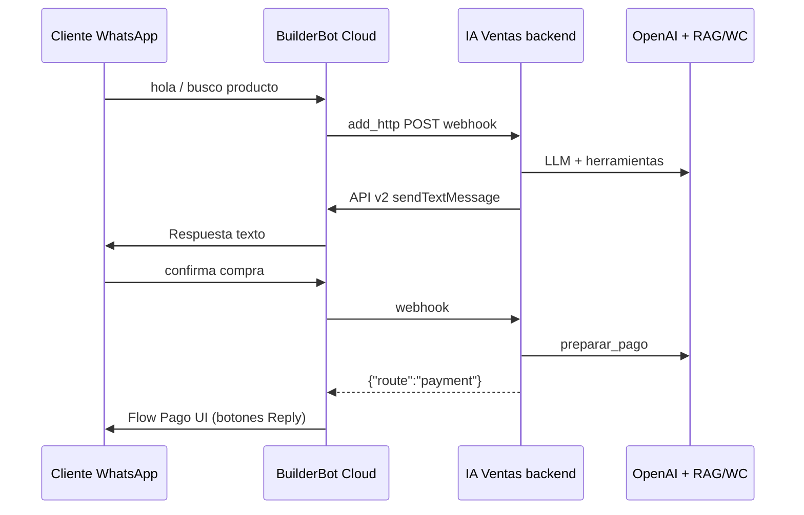

# WhatsApp + MASSI — Integración IA Ventas

> Guía operativa: agente LLM en texto libre + botones BBC **solo** en selección de método de pago.

---

## Arquitectura



| Componente | Rol |
|------------|-----|
| **BuilderBot Cloud** | WhatsApp, relay webhook (`add_http`), flow **Pago UI** con botones |
| **IA Ventas `sales-agent`** | Agente LLM; orquesta **solo** el paso `payment_select` |
| **Plugin `massi-bot-api` (WordPress)** | Pedidos MASSI, tickets, comprobantes → Drive/MDP |
| **WooCommerce REST** | Catálogo, stock, credenciales `ck_`/`cs_` por tenant |

### Envío de mensajes (cloud-v2)

| Tipo | Mecanismo |
|------|-----------|
| Texto (hola, productos, ayuda) | `POST /api/v2/{projectId}/messages` desde IA Ventas |
| Botones de pago | Webhook responde `{ "route": "payment" }` → regla HTTP → flow **IA Ventas — Pago UI** |

**Importante:** la API v2 **no** envía botones en el payload (`buttons` se ignoran). **No** uses `messageMapping` en el relay HTTP (BBC envía literalmente el nombre del campo, p. ej. `"message"` o `"reply"`).

Relay HTTP (`sync-webhook`):

- `avoidResponse: true`
- Regla: `route === "payment"` → flow Pago UI
- Sin `messageMapping`

---

## Configuración en panel (`/business/woocommerce`)

| Campo | Valor |
|-------|--------|
| URL tienda | `https://massijoyeria.local` (HTTPS obligatorio en local) |
| Consumer Key / Secret | Claves REST WooCommerce |
| Usuario WP (Bot) | Login del usuario bot en WordPress (no email) |
| Application Password | Contraseña de aplicación WP (24 chars), **no** la contraseña de login |

**Probar conexión** valida WC + MASSI Bot API.

---

## Plugin WordPress `massi-bot-api`

Ubicación local: `Local Sites/massijoyeria/.../wp-content/plugins/massi-bot-api/`

| Endpoint | Auth | Uso |
|----------|------|-----|
| `GET /wp-json/massi-bot/v1/ping` | Público | Health check |
| `GET /massi-bot/v1/clients?phone=` | App Password | Perfil cliente |
| `GET /massi-bot/v1/orders?phone=` | App Password | Pedidos recientes |
| `POST /massi-bot/v1/orders` | App Password | Crear pedido + ticket MASSI |
| `POST /massi-bot/v1/orders/{id}/payment-report` | App Password | Comprobante (URL imagen) |
| `GET /massi-bot/v1/products/{id}/variations` | App Password | Variaciones (balines, promos) |

Auth: header `Authorization: Basic base64(user:application_password)` + capability `massi_bot_access`.

---

## Flujo WhatsApp

### Conversación general (sin botones)

Saludos, búsqueda de productos, pedidos y ayuda → **agente LLM** en texto libre.

### Compra con MASSI conectado

1. Cliente busca producto (texto libre → LLM + herramientas WC/RAG).
2. LLM llama `preparar_pago` → valida stock, guarda carrito, **no crea pedido aún**.
3. Backend responde `{ "route": "payment" }` → BBC muestra botones en flow **Pago UI**.
4. Click en método → `POST /massi-bot/v1/orders` con `mdp_788` (Bre-B) o `mdp_789` (efectivo).
5. **Transferencia:** instrucciones bancarias + espera comprobante (imagen).
6. **Efectivo:** ticket provisional + indicación de ir a la joyería.

### Comprobante de pago

Imagen WhatsApp → webhook → `submitPaymentReport` en MASSI Bot API (si hay `massiWooOrderId` en sesión).

---

## Configurar botones en BuilderBot Cloud (una vez)

Tras **Re-sincronizar webhook** en panel IA Ventas → WhatsApp:

1. Abre [app.builderbot.cloud](https://app.builderbot.cloud) → proyecto del negocio.
2. Flow **IA Ventas — Pago UI** → bloque texto `Perfecto. Elige cómo deseas pagar:`.
3. **Botones interactivos → + Reply** (3 botones, no CTA URL):

| Texto | ID (si el panel lo pide) |
|-------|--------------------------|
| Transferencia | `massi:pay:transfer` |
| Efectivo tienda | `massi:pay:cash` |
| Menú principal | `massi:menu:back` |

4. **Guardar** el bloque en el editor (Reboot **no** guarda cambios).
5. Deploy / Reboot del bot en BBC.

**No tocar** el flow **IA Ventas — Agente** (relay HTTP). Puedes **eliminar** `IA Ventas — Menú UI` si existe; ya no se usa.

Modo **wa-api** (`console.builderbot.app`): botones vía `POST /messages` directo en el adapter.

---

## Backend — archivos clave

| Tema | Archivo |
|------|---------|
| Relay HTTP + reglas BBC | `builderbot/infrastructure/BuilderBotCloudWebhookRelay.ts` |
| Flow UI de pago (MCP) | `builderbot/infrastructure/BuilderBotCloudUiFlowsRelay.ts` |
| Respuesta webhook `{ route }` | `builderbot/domain/BbcWebhookAgentResponse.ts` |
| Webhook síncrono | `builderbot/presentation/controllers/WebhookController.ts` |
| Envío texto API v2 | `builderbot/infrastructure/BuilderBotCloudV2Adapter.ts` |
| Parser clicks de botones | `builderbot/application/services/BuilderBotWebhookParser.ts` |
| Paso pago + botones | `sales-agent/application/services/ConversationFlowService.ts` |
| Agente + envío híbrido | `sales-agent/application/services/SalesAgentService.ts` |
| IDs de botones | `sales-agent/domain/whatsappFlow.constants.ts` |
| Adapter MASSI REST | `massi-bot/infrastructure/MassiBotRestAdapter.ts` |

---

## Deploy producción (EC2)

```bash
cd ~/IA-Ventas-B
git pull origin main
npm run build
pm2 restart ia-ventas
```

Luego en panel → WhatsApp → **Re-sincronizar webhook**.

---

## Prueba manual (checklist)

- [ ] MASSI Bot + WC conectados en panel
- [ ] WhatsApp escaneado (cloud-v2, `APP_PUBLIC_URL` público)
- [ ] **Re-sincronizar webhook** tras cada deploy que toque relay/BBC
- [ ] Escribir **hola** → **un** mensaje de texto del agente (sin botones)
- [ ] Buscar producto → confirmar compra → **botones** Transferencia / Efectivo / Menú
- [ ] **Transferencia** → datos bancarios → enviar imagen comprobante
- [ ] Pedir pedidos por texto libre al agente (sin menú con botones)

---

## Pendiente (roadmap)

- Listas WhatsApp para variaciones de productos variables
- Webhook WC → notificación WhatsApp en cambios de `_massi_operational_status`
- OTP registro usuario WP vía BuilderBot
- Tests E2E automatizados

---

*Última actualización: 24 julio 2026 — texto vía API v2, botones solo en pago vía flow BBC, sin messageMapping.*
