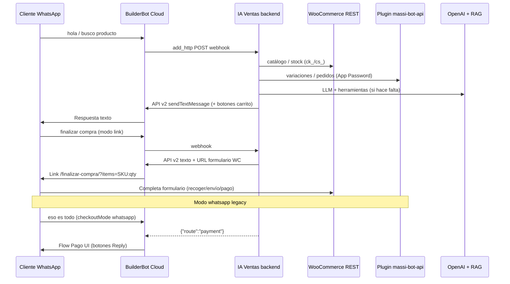
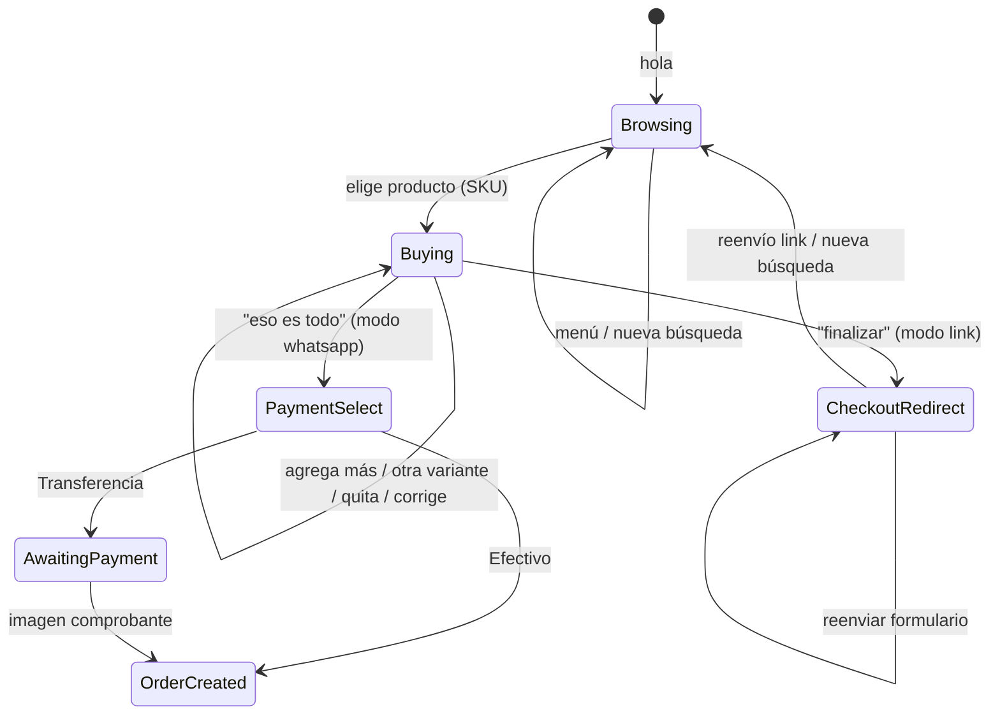

# WhatsApp + MASSI — Integración IA Ventas

> Guía operativa: agente LLM en texto libre + botones BBC **solo** en selección de método de pago.  
> **Catálogo:** cualquier producto WooCommerce (simple o variable) identificado por **SKU**.  
> **Contexto de negocio** (QR en tienda, clientes remotos, formularios WC, tickets, OTP): [`business-flow-massi.md`](./business-flow-massi.md).

---

## Arquitectura



| Componente | Rol |
|------------|-----|
| **BuilderBot Cloud** | WhatsApp, relay webhook (`add_http`), flow **Pago UI** con botones |
| **IA Ventas `sales-agent`** | Agente LLM + atajos deterministas (carrito, SKU, modificar carrito); checkout link o pago legacy |
| **WooCommerce REST** (`ck_`/`cs_`) | Búsqueda catálogo, productos simples, fallback stock por SKU |
| **Plugin `massi-bot-api` (WordPress)** | Variaciones enriquecidas, lookup por SKU, pedidos MASSI, tickets, comprobantes |
| **RAG (documentos panel)** | Interpretar intención del cliente → **SKU** del catálogo `.txt` vectorizado. **No** precios ni stock (siempre WC) |

### Envío de mensajes (cloud-v2)

| Tipo | Mecanismo |
|------|-----------|
| Texto (saludo, resumen de carrito) | `POST /api/v2/{projectId}/messages` — `sendTextMessage` |
| Botón **Finalizar pedido** (con carrito activo) | API v2 — `sendButtonsMessage` (`buttons` + `interactive type: button`) |
| Botones **Finalizar pedido** + **Vaciar carrito** (saludo con carrito) | API v2 — `sendButtonsMessage` |
| Botón **Ver catálogo** (CTA URL) | API v2 — `sendCtaUrlMessage`: mensaje texto + segundo mensaje con botón (`buttons`+`url`, `buttonUrl`, `interactive cta_url`) |
| Botón **Continuar compra** (CTA URL al formulario WC) | API v2 — `sendCtaUrlMessage` con la URL de checkout |
| Botones de pago (modo `whatsapp` legacy) | Webhook `{ "route": "payment" }` → flow **IA Ventas — Pago UI** |

**Un mensaje = un tipo de botón.** WhatsApp no permite mezclar botones de respuesta con un botón de enlace, así que el saludo con carrito se envía en **dos mensajes**: acciones primero, catálogo después (`OutboundWhatsAppPayload` acepta un arreglo de mensajes).

**Importante:** carrito y catálogo se envían desde **IA Ventas** vía API v2. **No** uses `messageMapping` en el relay HTTP.

Relay HTTP (`sync-webhook`):

- `avoidResponse: true`
- Regla: `route === "payment"` → flow Pago UI
- Sin `messageMapping`

---

## Modelo de productos (WooCommerce)

Aplica a **cualquier negocio** con catálogo WC, no solo joyería.

| Tipo WC | Comportamiento del agente |
|---------|---------------------------|
| **Simple** | Un SKU, un precio, un stock |
| **Variable** | Producto padre + variaciones (medida, talla, color, modelo, etc.). **Cada variación debe tener SKU único** |
| **Sin SKU** | El agente avisa que falta SKU en la tienda; no puede agregar al carrito de forma fiable |

### Identificador principal: SKU

1. **Búsqueda:** `buscar_productos_tienda` → WC REST + variaciones vía MASSI (si está configurado).
2. **Resolución exacta:** `GET /massi-bot/v1/products/by-sku?sku=...` (preferido) o `GET /wc/v3/products?sku=...`.
3. **Carrito:** cada línea guarda `productId`, `variationId?`, `sku`, `name`, `quantity`, `unitPrice`.
4. **Pedido MASSI:** `line_items` con `product_id` + `variation_id` + `quantity`.

### Atributos de variación reconocidos en texto libre

El backend interpreta hints genéricos (no hardcodeados por categoría):

- Medidas: `45 cm`, `50mm`, `10 gr`
- Tallas: `talla M`, `size L`, `XL`
- Colores: `rojo`, `color azul`, `en negro`
- Modelos: `#3`, `modelo 5`
- Cantidad: `2 unidades`, `x3`

Con **carrito activo**, mensajes cortos como *"otra de 45 cm"*, *"talla M"* o *"en rojo"* resuelven otra variación del **mismo producto padre** que el último ítem del carrito.

---

## Configuración en panel (`/business/woocommerce`)

> **Guía paso a paso (usuario bot, Application Password, plugin, ngrok):** [`woocommerce-setup-massi.md`](./woocommerce-setup-massi.md)

| Campo | Valor |
|-------|--------|
| URL tienda | HTTPS público en prod; en local: ngrok → Local WP (ej. `https://xxxx.ngrok-free.app`) |
| Consumer Key / Secret | Claves REST WooCommerce (`ck_` / `cs_`) |
| Usuario WP (Bot) | Login del usuario bot en WordPress (no email) |
| Application Password | Contraseña de aplicación WP (24 chars), **no** la contraseña de login |

**Probar conexión** valida WC REST + MASSI Bot API (`/ping` + auth).

> **Dev local:** EC2/prod debe alcanzar la URL pública de la tienda. Si usas Local WP + ngrok, mantén ngrok activo; un 502 de nginx indica tienda caída o túnel expirado.

---

## Plugin WordPress `massi-bot-api`

Ubicación local: `Local Sites/{sitio}/.../wp-content/plugins/massi-bot-api/`

| Endpoint | Auth | Uso |
|----------|------|-----|
| `GET /wp-json/massi-bot/v1/ping` | Público | Health check |
| `GET /massi-bot/v1/clients?phone=` | App Password | Perfil cliente |
| `GET /massi-bot/v1/orders?phone=` | App Password | Pedidos recientes |
| `POST /massi-bot/v1/orders` | App Password | Crear pedido + ticket MASSI |
| `POST /massi-bot/v1/orders/{id}/payment-report` | App Password | Comprobante (URL imagen) |
| `GET /massi-bot/v1/products/{id}/variations` | App Password | Variaciones con atributos y SKU |
| `GET /massi-bot/v1/products/by-sku?sku=` | App Password | Producto o variación por SKU exacto |

Auth: header `Authorization: Basic base64(user:application_password)` + capability `massi_bot_access`.  
En hostings que no reenvían `Authorization`, el plugin usa `class-massi-bot-auth.php` → `fix_authorization_header()`.

**Instalación prod:** subir `dist/massi-bot-api-ia-ventas.zip` manualmente en WP (ver [`woocommerce-setup-massi.md`](./woocommerce-setup-massi.md) §13).

**Sin MASSI Bot API:** el agente puede buscar en WC REST, pero variaciones y pedidos MASSI completos no están disponibles.

---

## Flujo conversacional esperado

### Fases de sesión (`SalesContext`)

| Fase / paso | Significado |
|-------------|-------------|
| `phase: browsing` | Exploración o armando pedido |
| `flowStep: buying` | Carrito con al menos un ítem; cliente puede agregar, quitar o corregir |
| `flowStep: checkout_redirect` | Carrito cerrado (modo `link`); cliente debe completar formulario WC |
| `flowStep: payment_select` | Carrito cerrado (modo `whatsapp` legacy); esperando botón de pago |
| `phase: awaiting_payment` | Pedido MASSI creado; esperando comprobante (transferencia) |
| `phase: order_created` | Pedido registrado (efectivo o pago confirmado) |

### Diagrama de conversación (venta típica)



### 1. Saludo (determinista)

El saludo se bifurca según **si la sesión ya tenía carrito**.

**Sin carrito** (`flowStep: discovery`):

| Cliente | Sistema |
|---------|---------|
| `hola`, `menú`, `buenos días` | Texto: bienvenida + **perfil negocio** (descripción, 📍 dirección, 🕐 horario desde `/business/settings`) |
| (continúa) | Pide **ID del producto** (SKU amigable) o descripción en lenguaje natural |
| (continúa) | Segundo mensaje: botón **Ver catálogo** → `{storeUrl}{shopPagePath}` (MASSI: `https://massijoyeria.com/tienda/`) |

Sin botones Reply en este caso (solo CTA URL al catálogo).

**Con carrito previo** (`flowStep: buying`, `buildWelcomeWithCart`):

| Mensaje | Contenido |
|---------|-----------|
| 1 | Bienvenida + perfil + **resumen del carrito** + aviso de que puede enviar un **ID** para agregar o cambiar productos · botones **Finalizar pedido** y **Vaciar carrito** |
| 2 | Botón **Ver catálogo** (CTA URL) |

**Vaciar carrito** (`massi:cart:clear`) limpia `cartItems` y devuelve al paso de pedir ID. El LLM **no** debe repetir un saludo genérico si ya se envió.

### 2. Exploración de catálogo

| Cliente | Sistema |
|---------|---------|
| `¿qué productos tienen?`, `catálogo`, `qué venden` | **Determinista** → `buildCatalogBrowseReply`: mensaje corto + botón **Ver catálogo** (no lista productos en chat) |
| Cliente envía **ID/SKU** | Atajo → `buildOrderItemBySku` → stock WC → carrito |
| Cliente describe producto (*cadena 50 cm*, *balín #6*) | **RAG** (`resolveSkuFromRag` + parser `.txt`) → SKU → stock WC → carrito; fallback búsqueda WC por nombre |
| `busco zapatos`, consulta abierta al LLM | LLM → `buscar_en_documentos` (RAG) + `agregar_producto_por_sku` / `buscar_productos_tienda` |

**Regla:** el agente **nunca inventa** productos ni precios. **RAG** identifica SKU; **WooCommerce** confirma stock y precio.

### 3. Agregar al carrito

| Cliente | Sistema |
|---------|---------|
| `quiero [producto] [variante]` | Atajo determinista → resuelve variación → agrega → resumen + invitación a enviar otro *ID* · único botón: **Finalizar pedido** |
| `cadena 45cm y balín #3` (varios productos) | `parseMultiProductSelection` → resuelve cada segmento; éxito parcial si uno no existe en WC |
| `otra de 45 cm` (con carrito activo) | Misma familia de producto → variación hermana por atributo |
| `quisiera agregar una [producto]` | Producto concreto; typos (`agreagar`) se normalizan |

**Reglas del carrito:**

- Varios productos distintos en un mensaje (`y cadena… y anillo…`) → una línea por SKU.
- Varias medidas del **mismo** producto (`45cm y 50cm`) → `parseMultiVariantSelection`.
- Mismo SKU en carrito → incrementa cantidad.
- Producto no encontrado en WC → mensaje explícito; no se agrega.

### 3b. Modificar carrito (determinista, cualquier catálogo)

| Cliente | Sistema |
|---------|---------|
| `quitar 2 balines #3`, `eliminar anillo talla 6` | Quita cantidad del ítem que coincida (nombre + variante + SKU) |
| `no quiero las de 50cm, solo una de 45cm` | Corrige: quita lo indicado y deja/agrega lo pedido |
| `deja solo 2 balines` | Ajusta cantidad exacta |
| `vaciar carrito`, `quisiera eliminar mi carrito`, `empezar de cero` | Limpia sesión de carrito (`isCartClearIntent`) |

Matching contra **ítems ya en carrito** (no busca productos nuevos en tienda salvo corrección que requiere agregar).

### 4. Finalizar compra (modo link — default)

| Cliente | Sistema |
|---------|---------|
| `eso es todo`, `finalizar con la compra`, botón **Finalizar pedido** | Valida stock → resumen del carrito + segundo mensaje con botón **Continuar compra** (CTA URL al formulario WC) |
| `reenvía el link` / `formulario` | Reenvía el mismo botón/URL (`flowStep: checkout_redirect`) |

Si BBC rechaza el CTA URL, el adapter cae a texto con el enlace, así que el cliente nunca se queda sin link.

URL generada (`checkoutLink.utils.ts`):

```
{checkoutFormUrl || checkoutPagePath || /checkout/}?phone=573…&source=whatsapp&public_store={storeUrl}&items=SKU:qty,SKU:qty
```

- `checkoutPagePath` se detecta al probar conexión WC (MASSI: `/finalizar-compra/`)
- Plugin WP pre-carga carrito y teléfono (ver § Plugin checkout link abajo)

El cliente elige en la **web**: recoger en tienda, domicilio, transferencia o efectivo.

### 4b. Finalizar compra (modo whatsapp — legacy)

| Cliente | Sistema |
|---------|---------|
| `eso es todo` (con `checkoutMode: whatsapp`) | Botones BBC Transferencia / Efectivo |

### 5. Método de pago (botones BBC — determinista)

Flow **IA Ventas — Pago UI**:

| Botón | ID | Acción |
|-------|-----|--------|
| Transferencia | `massi:pay:transfer` | `POST /massi-bot/v1/orders` (`mdp_788`) + datos bancarios |
| Efectivo tienda | `massi:pay:cash` | Pedido + ticket provisional (`mdp_789`) |
| Menú principal | `massi:menu:back` | Cancela selección de pago |

### 6. Comprobante (imagen)

Imagen WhatsApp → webhook → `submitPaymentReport` si hay `massiWooOrderId` en sesión.

### 7. Errores de tienda

Si WooCommerce responde 502/503 (túnel caído, Local WP apagado):

- El agente responde con mensaje amable (no silencio).
- Se conserva el resumen del carrito si existía.
- Reintentos automáticos (×3) en el adapter WC.

---

## Formato catálogo RAG (`.txt` subido al panel)

El documento vectorizado (Pinecone) usa bloques separados por `---`:

```
Producto: Balines diamantados #6
SKU: BAL-DI6-01
BAL-DI6-02
...
Milímetros: 6.0
Variaciones: 1 Balín|2 Balines|5 Balines|10 Balines
ESTADO: Listo
```

`catalogRag.utils.ts` parsea bloques, puntúa coincidencia con el texto del cliente y elige SKU (p. ej. pack 5 → `BAL-DI6-05`). Luego **WC** valida stock.

---

## URL catálogo WooCommerce

| Campo | Origen | Ejemplo MASSI |
|-------|--------|---------------|
| `storeUrl` | Panel `/business/woocommerce` | `https://massijoyeria.com` |
| `shopPagePath` | Auto-detect al **Probar conexión** (`woocommerce_shop_page_id`) | `/tienda/` |
| URL final | `resolveStoreCatalogUrl(storeUrl, shopPagePath)` | `https://massijoyeria.com/tienda/` |

Si `shopPagePath` no está en DB pero WC conectado, se resuelve al vuelo en `ConversationFlowService.resolveCatalogUrl`.

---

## Ejemplo E2E (MASSI — jul 2026)

```
Cliente: hola
Bot:     ¡Hola! Bienvenido a MASSI JOYERIA.
         Somos fabricantes de joyas en oro 18K…
         📍 [dirección]  🕐 [horario]
         Dime el ID del producto o productos que te interesan…
Bot:     [botón Ver catálogo → massijoyeria.com/tienda/]

Cliente: qué productos tienen
Bot:     Estos son nuestros productos… revisa el catálogo en el siguiente enlace.
         [botón Ver catálogo]

Cliente: BAL-DI6-01
Bot:     ¡Listo! Agregué Balín diamantado #6…
         Dime el ID de otro producto o pulsa Finalizar pedido.
         [Finalizar pedido]

Cliente: quisiera eliminar mi carrito
Bot:     Listo, vacié tu carrito. ¿Qué te gustaría pedir?

Cliente: cadena de oro 50 cm
Bot:     (RAG → SKU cadena 50cm → WC stock) → agrega al carrito…

Cliente: [Finalizar pedido]
Bot:     ¡Perfecto! Tu selección está lista… (resumen)
Bot:     Completa tu compra aquí 👇
         [Continuar compra → massijoyeria.com/finalizar-compra/?phone=…&items=SKU:qty]

--- Si vuelve más tarde con el carrito cargado ---

Cliente: hola
Bot:     ¡Hola! Bienvenido a MASSI JOYERIA… Tienes un pedido en curso: (resumen)
         [Finalizar pedido | Vaciar carrito]
Bot:     Si quieres ver más productos, revisa el catálogo:
         [Ver catálogo]
```

Misma lógica aplica a cualquier catálogo WC (medidas, tallas, packs de variación, etc.).

**Modo `whatsapp` legacy:** tras “eso es todo” → botones Transferencia / Efectivo → pedido MASSI en chat (ver §4b).

---

## BuilderBot Cloud — resumen

> Detalle completo (modo link vs whatsapp, qué tocar en BBC): [`woocommerce-setup-massi.md`](./woocommerce-setup-massi.md) §11.

| Modo checkout | Qué pasa en BBC |
|---------------|-----------------|
| **`link` (default)** | Solo relay + API v2 texto (incluye URL formulario). **No** se dispara flow Pago UI. |
| **`whatsapp` (legacy)** | Webhook `{ "route": "payment" }` → flow **Pago UI** con botones Reply. |

**Sin cambios obligatorios en BBC** al pasar a modo link. Re-sincronizar webhook tras deploy sigue siendo buena práctica.

---

## Plataforma BuilderBot Cloud — referencia técnica

> Fuente: esquemas del MCP `builderbot-cloud` + skill oficial [`leifermendez/bbc-skill-mcp`](https://github.com/leifermendez/bbc-skill-mcp) (`bbc-skill-tool` v2.1).
> Instalar el skill localmente: `npx skills add https://github.com/leifermendez/bbc-skill-mcp --skill bbc-skill-tool -y`

### Tres superficies distintas (no confundir)

| Superficie | Para qué sirve | Base URL | Auth |
|------------|----------------|----------|------|
| **MCP** | Construir el bot: proyectos, flows, answers, deploy, QR, reboot, logs, validación | `https://bbc-mcp-http.builderbot.cloud/mcp/builderbot/mcp` (JSON-RPC `tools/call`) | `x-builderbot-api-key` |
| **Manager API** | Deploys y QR por HTTP directo | `https://app.builderbot.cloud/api/v1/manager` | `x-api-builderbot` |
| **API v2** | Enviar mensajes salientes desde el backend | `https://app.builderbot.cloud/api/v2/{projectId}/messages` | `x-api-builderbot` |

El MCP **solo construye bots**. Para enviar un mensaje del servidor a un contacto se usa la API v2 — no existe herramienta MCP para eso.

### Herramientas MCP disponibles

| Herramienta | Muta | Uso en IA Ventas |
|-------------|------|------------------|
| `builderbot_list_projects` | No | `listBuilderBotCloudProjects` (verificar existencia) |
| `builderbot_create_project` | Sí | Provision al crear negocio |
| `builderbot_update_project` / `builderbot_get_project` | Sí / No | — |
| `builderbot_delete_project` | Sí (destructiva) | `TenantDeletionService` |
| `builderbot_list_flows` | No | Relay + UI flows |
| `builderbot_create_flow` / `builderbot_update_flow` | Sí | Relay + UI flows |
| `builderbot_delete_flow` | Sí (destructiva) | — |
| `builderbot_list_answers` | No | Relay + UI flows |
| `builderbot_create_answer` / `builderbot_update_answer` / `builderbot_delete_answer` | Sí | Relay (`add_http`) + Pago UI (`add_text`) |
| `builderbot_deploy` (`create`/`status`/`qr`/`reboot`/`delete`) | Parcial | `reboot` tras sync; deploy/QR van por manager API |
| `builderbot_validate_bot` | No | ❌ **No usado** — ver gaps |
| `builderbot_read_logs` | No | ❌ **No usado** — ver gaps |
| `builderbot_install_skill_bbc` | No | Devuelve el comando de instalación del skill |

> **No existen** (aunque las descripciones del MCP las mencionan): `builderbot_audit_keywords`, `builderbot_check_flows_with_answers`. No intentar llamarlas.

### Reglas duras de flows y answers

Violarlas produce fallos **silenciosos**, no errores:

| Regla | Detalle |
|-------|---------|
| `listenKeywords: false` | Obligatorio en **todos** los flows excepto `EVENTS.VOICE_NOTE` (incluido `EVENTS.WELCOME`) |
| Un `EVENTS.*` por proyecto | El evento literal solo puede estar en **un** flow; duplicarlo hace que solo dispare uno |
| `plugins.http.rules` obligatorio | Aunque vaya vacío (`[]`); si falta, el backend rechaza el answer |
| `add_chatpdf` aislado | Un flow con `add_chatpdf` no puede tener otro answer → doble respuesta en cada turno |
| `capture` nunca al final | `options.capture: true` en el último answer descarta el valor en silencio |
| Flow nuevo = 0 answers | No responde hasta agregar al menos un answer |

**Eventos del sistema:** `EVENTS.WELCOME` (catch-all), `EVENTS.VOICE_NOTE` (+`transcribeAudio`), `EVENTS.MEDIA` (+`interpretImage`), `EVENTS.DOCUMENT` (+`analyzeDocument`), `EVENTS.LOCATION`, `EVENTS.ACTION`.

**Multi-acción:** no usar `EVENTS.ACTION` para varias acciones (solo cabe en un flow). El patrón soportado son reglas `plugins.openai.rules` desde un `add_chatpdf` hacia flows con label propio. **No aplica a IA Ventas**: nuestra IA vive en el backend, no en BBC.

### Variables de sistema (plantillas en answers)

| Variable | Significado |
|----------|-------------|
| `{from}` | Número de WhatsApp del contacto |
| `{name}` | Nombre visible del contacto |
| `{aiResponse}` | Texto generado por el `add_chatpdf` anterior |
| `{time}` / `{date}` / `{fullDate}` | Reloj del **servidor BBC**, no la zona horaria del negocio |

⚠️ El relay de IA Ventas también usa **`{body}`** (texto del cliente), que **no está en la lista documentada**. Funciona en producción (viene del `ctx.body` del framework) y `BuilderBotWebhookParser` descarta plantillas sin sustituir, pero es una dependencia no documentada.

### Límites de WhatsApp

| Elemento | Límite |
|----------|--------|
| Texto de answer | ≤ 160 caracteres recomendado (`validate_bot` avisa) |
| Etiqueta de botón | ≤ 20 caracteres (el adapter recorta) |
| Filas de lista | ≤ 10 por sección (el adapter recorta) |
| Media | URL pública; las privadas fallan en silencio |

### Estados de deploy

| Estado | Significado | Acción |
|--------|-------------|--------|
| `CONNECTED` | Bot vivo recibiendo mensajes | Ninguna |
| `READY_TO_SCAN` | Desplegado, esperando QR | Mostrar QR en `/business/whatsapp` |
| `INITIALIZATION` | Arrancando | Reintentar status en ~30s |
| `FAILED` | Deploy caído | Reboot o recrear |

`BuilderBotCloudV2Adapter.mapStatus` traduce estos valores a `connected` / `connecting` / `disconnected`.

### Gaps y limitaciones conocidas

| Tema | Estado |
|------|--------|
| **Imágenes de comprobante** | Solo provisionamos `EVENTS.WELCOME`. Las imágenes entran por `EVENTS.MEDIA` (`interpretImage: true`) en su propio flow → **verificar** si el relay dispara con imágenes antes de dar por bueno el comprobante legacy |
| **Notas de voz / documentos** | Sin flow provisionado (`EVENTS.VOICE_NOTE`, `EVENTS.DOCUMENT`) |
| `builderbot_validate_bot` | Sin usar; encajaría al final de **Re-sincronizar webhook** (detecta flows vacíos, eventos duplicados, capturas colgantes) |
| `builderbot_read_logs` | Sin usar; es la vía más rápida para depurar un webhook que no dispara en prod |
| **Blacklist** | BBC Cloud **no** expone endpoint REST. El `bot.blacklist` de la doc es del framework self-hosted; filtrar del lado de IA Ventas |
| **`add_chatpdf` sin tool calling** | No puede llamar HTTP por sí mismo; solo enruta por reglas. Irrelevante para nosotros (IA en backend) |

---

## Configurar botones en BuilderBot Cloud (solo modo `whatsapp`)

Tras **Re-sincronizar webhook** en panel IA Ventas → WhatsApp:

1. Abre [app.builderbot.cloud](https://app.builderbot.cloud) → proyecto del negocio.
2. Flow **IA Ventas — Pago UI** → bloque texto `Perfecto. Elige cómo deseas pagar:`.
3. **Botones interactivos → + Reply** (3 botones, no CTA URL):

| Texto | ID (si el panel lo pide) |
|-------|--------------------------|
| Transferencia | `massi:pay:transfer` |
| Efectivo tienda | `massi:pay:cash` |
| Menú principal | `massi:menu:back` |

4. **Guardar** el bloque en el editor (Reboot **no** guarda cambios).
5. Deploy / Reboot del bot en BBC.

**No tocar** el flow **IA Ventas — Agente** (relay HTTP). Puedes **eliminar** `IA Ventas — Menú UI` si existe; ya no se usa.

Modo **wa-api** (`console.builderbot.app`): botones vía `POST /messages` directo en el adapter.

---

## Backend — archivos clave

| Tema | Archivo |
|------|---------|
| Relay HTTP + reglas BBC | `builderbot/infrastructure/BuilderBotCloudWebhookRelay.ts` |
| Cliente MCP HTTP (JSON-RPC) | `builderbot/infrastructure/BuilderBotMcpHttpClient.ts` |
| Flow UI de pago (MCP) | `builderbot/infrastructure/BuilderBotCloudUiFlowsRelay.ts` |
| Respuesta webhook `{ route }` | `builderbot/domain/BbcWebhookAgentResponse.ts` |
| Webhook síncrono | `builderbot/presentation/controllers/WebhookController.ts` |
| Envío texto API v2 | `builderbot/infrastructure/BuilderBotCloudV2Adapter.ts` |
| Parser clicks de botones | `builderbot/application/services/BuilderBotWebhookParser.ts` |
| Paso pago + botones | `sales-agent/application/services/ConversationFlowService.ts` |
| Agente + carrito + SKU | `sales-agent/application/services/SalesAgentService.ts` |
| Carrito (merge, quitar, qty) | `sales-agent/application/services/CartService.ts` |
| Modificación carrito (intents) | `sales-agent/domain/cartModification.utils.ts` |
| Resolución producto/variante | `sales-agent/application/services/SalesAgentToolsHandler.ts` |
| Catálogo WC (enlace) | `ConversationFlowService.buildCatalogBrowseReply` |
| RAG → SKU | `sales-agent/domain/catalogRag.utils.ts`, `SalesAgentToolsHandler.resolveSkuFromRag` |
| URL catálogo | `sales-agent/domain/catalogUrl.utils.ts` |
| Multi-producto / variantes | `sales-agent/domain/productSelection.utils.ts` |
| Link checkout WC | `sales-agent/domain/checkoutLink.utils.ts` |
| IDs de botones | `sales-agent/domain/whatsappFlow.constants.ts` |
| Adapter MASSI REST | `massi-bot/infrastructure/MassiBotRestAdapter.ts` |
| Adapter WooCommerce REST | `woocommerce/infrastructure/WooCommerceRestAdapter.ts` |

---

## Deploy producción (EC2)

```bash
cd ~/IA-Ventas-B
git pull origin main
npm run build
pm2 restart ia-ventas
```

Luego en panel → WhatsApp → **Re-sincronizar webhook**.

---

## Prueba manual (checklist)

- [ ] MASSI Bot + WC conectados en panel
- [ ] WhatsApp escaneado (cloud-v2, `APP_PUBLIC_URL` público)
- [ ] Tienda WC accesible desde el servidor (ngrok estable si es local)
- [ ] **Re-sincronizar webhook** tras cada deploy que toque relay/BBC
- [ ] **Probar conexión** WC (detecta `checkoutPagePath` + `shopPagePath` → `/tienda/`)
- [ ] **hola** (sin carrito) → saludo con perfil negocio + pide ID + botón **Ver catálogo**
- [ ] **hola** (con carrito previo) → saludo + resumen + botones **Finalizar pedido** / **Vaciar carrito** + botón **Ver catálogo**
- [ ] Botón **Vaciar carrito** → carrito vacío + vuelve a pedir ID
- [ ] **qué productos tienen** → enlace catálogo (no lista en chat)
- [ ] **ID/SKU** o descripción natural → carrito + botón **Finalizar pedido**
- [ ] **quisiera eliminar mi carrito** → vacía carrito
- [ ] **Dos productos** en un mensaje (`cadena y balín`) → ambos si existen en WC
- [ ] Segunda variante del mismo producto (*otra de X*) → suma al carrito
- [ ] Quitar / corregir / vaciar carrito → resumen actualizado
- [ ] **finalizar con la compra** → botón **Continuar compra** → formulario WC con `items=SKU:qty`
- [ ] Abrir link → productos pre-cargados (plugin checkout link)
- [ ] (Legacy) **eso sería todo** con `checkoutMode: whatsapp` → botones Transferencia / Efectivo
- [ ] **Transferencia** (legacy) → datos bancarios → imagen comprobante
- [ ] Producto **simple** y **variable** (cualquier categoría WC)

---

## Pendiente (roadmap)

Ver tabla completa y prioridades en [`business-flow-massi.md`](./business-flow-massi.md) §5.

| Item | Resumen |
|------|---------|
| Recoger vs domicilio | `delivery_type: delivery` + datos envío (hoy solo `pickup`) |
| Formulario WC / link checkout | ✅ Plugin pre-carga carrito; formularios en WordPress |
| Perfil cliente por teléfono | `GET /clients?phone=` — adapter listo, agente no usa |
| Webhook estado → WhatsApp | `_massi_operational_status`; hoy solo email WC |
| OTP Mi cuenta vía WhatsApp | Misma línea BuilderBot; coordinar con plugin WP |
| Listas WhatsApp variaciones | Elegir variante sin texto libre |
| Tests E2E automatizados | — |

---

## Plugin WP — pre-carga carrito desde link

**Implementado** en `massi-bot-api` → `class-massi-bot-checkout-link.php` (+ `class-massi-bot-ngrok-url.php` para dev).

Al abrir el link generado por IA Ventas:

```
https://{tienda}/finalizar-compra/?phone=573103534207&source=whatsapp&public_store=https%3A%2F%2F{tienda}&items=SKU-A:1,SKU-B:2
```

El plugin:

1. Vacía el carrito WC y agrega productos/variaciones por **SKU**
2. Guarda el teléfono en sesión → pre-rellena `billing_phone` en checkout
3. Evita redirect a `/carrito/` con carrito vacío (filter `woocommerce_checkout_redirect_empty_cart`)
4. `public_store` reescribe assets cuando la tienda se accede vía ngrok

**Requisito:** SKUs en todas las variaciones publicadas; ruta checkout configurable (`checkoutFormUrl` o auto-detect `/finalizar-compra/`). Solo productos en WC se listan/venden por WhatsApp.

---

*Última actualización: 30 julio 2026 — saludo con carrito (botones Finalizar/Vaciar), botón **Continuar compra** en el cierre, un solo botón durante el armado; referencia técnica plataforma BBC (MCP, reglas de flows, límites, gaps).*
