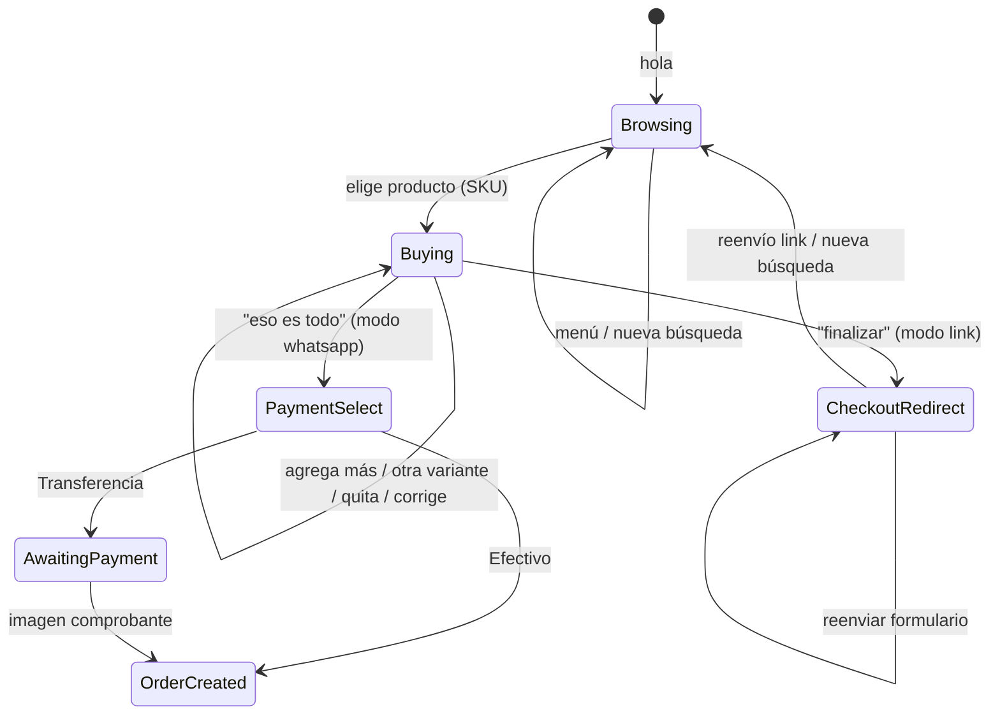

# WhatsApp + MASSI — Integración IA Ventas

> Guía operativa: agente LLM en texto libre + **flows UI de BBC para los botones**. La API v2 solo envía texto, así que los botones se configuran a mano en el panel y el webhook los dispara con `{ route }`.  
> **Catálogo:** cualquier producto WooCommerce (simple o variable) identificado por **SKU**.  
> **Contexto de negocio** (QR en tienda, clientes remotos, formularios WC, tickets, OTP): [`business-flow-massi.md`](./business-flow-massi.md).

---

## Arquitectura

```mermaid
sequenceDiagram
  participant C as Cliente WhatsApp
  participant BBC as BuilderBot Cloud
  participant API as IA Ventas backend
  participant WC as WooCommerce REST
  participant MASSI as Plugin massi-bot-api
  participant IA as OpenAI + RAG

  C->>BBC: hola / busco producto
  BBC->>API: add_http POST webhook
  API->>WC: catálogo / stock (ck_/cs_)
  API->>MASSI: variaciones / pedidos (App Password)
  API->>IA: LLM + herramientas (si hace falta)
  API->>BBC: API v2 sendTextMessage (texto dinámico)
  BBC->>C: Respuesta texto
  API-->>BBC: {"route":"catalog" | "cart"}
  BBC->>C: Flow UI con botones

  C->>BBC: finalizar compra (modo link)
  BBC->>API: webhook
  API->>BBC: API v2 texto + URL formulario WC
  BBC->>C: Link /finalizar-compra/?items=SKU:qty
  C->>WC: Completa formulario (recoger/envío/pago)

  Note over C,MASSI: Modo whatsapp legacy (sin flow Pago UI)
  C->>BBC: eso es todo (checkoutMode whatsapp)
  API->>BBC: API v2 texto (opciones pago; wa-api puede usar botones nativos)
```

| Componente | Rol |
|------------|-----|
| **BuilderBot Cloud** | WhatsApp, relay webhook (`add_http`), flows UI **Saludo Sin/Carrito** con botones |
| **IA Ventas `sales-agent`** | Agente LLM + atajos deterministas (carrito, SKU, modificar carrito); checkout link o pago legacy |
| **WooCommerce REST** (`ck_`/`cs_`) | Búsqueda catálogo, productos simples, fallback stock por SKU |
| **Plugin `massi-bot-api` (WordPress)** | Variaciones enriquecidas, lookup por SKU, pedidos MASSI, tickets, comprobantes |
| **RAG (documentos panel)** | Interpretar intención del cliente → **SKU** del catálogo `.txt` vectorizado. **No** precios ni stock (siempre WC) |

### Envío de mensajes (cloud-v2)

| Tipo | Mecanismo |
|------|-----------|
| Texto (saludo, resumen de carrito) | `POST /api/v2/{projectId}/messages` — `sendTextMessage` |
| Botón **Ver catálogo** (CTA URL) | Webhook `{ "route": "catalog" }` → flow **IA Ventas — Catalogo** |
| Botón **Vaciar carrito** (saludo con carrito) | Webhook `{ "route": "cart" }` → flow **IA Ventas — Vaciar Carrito** |
| OTP / estado pedido (MASSI Tickets) | `POST /api/v1/channel/messages` desde WordPress (`purpose: otp` \| `order_status`) |
| Pago legacy (`checkoutMode: whatsapp`) | Texto por API v2 (cloud-v2); botones nativos solo en wa-api — **sin** flow Pago UI en BBC |
| Enlace al formulario WC (finalizar compra) | Texto por API v2 — **sin botón** (ver «El checkout no puede ser botón») |

### Dónde viven los botones (verificado jul 2026)

Los botones **solo** existen en flows del panel BBC. Ni la API v2 ni el MCP pueden enviarlos ni guardarlos:

| Vía | Resultado de la prueba |
|-----|------------------------|
| `POST /api/v2/{projectId}/messages` con `buttons` | `200`, pero la respuesta ecoa solo `message`; los logs del contenedor reciben `Message payload: <content>` sin botones. El esquema Zod valida únicamente `messages.content`, `number` y `checkIfExists` |
| MCP `create_answer` con `buttons` en la raíz | `unrecognized_keys: 'buttons'` |
| MCP `create_answer` con `buttons` en `options` | `200`, pero al releer el answer solo persisten `sensitive`, `capture` y `delay` |
| REST `/api/v1/manager/flows|answers/...` | `404` con la API key; solo responde `/manager/deploys/{projectId}` |
| Panel BBC → bloque de texto → **Botones interactivos** | ✅ Reply, CTA URL, lista interactiva y header |

**Reparto de responsabilidades:**

| Elemento | Automático (MCP) | Manual (panel) |
|----------|------------------|----------------|
| Flow, keywords, orden | ✅ | |
| Texto del mensaje | ✅ (solo al crear el flow) | Editar copy |
| Reglas de routing `add_http` | ✅ | |
| Botones Reply / CTA URL | | ✅ **una vez por negocio** |

`supportsInteractiveMessages()` devuelve `false` en cloud-v2 y `true` en wa-api (`console.builderbot.app`), único transporte con botones nativos por API.

### Routing a flows UI

El webhook responde `{ route }` **después** de que el agente envió sus textos por API v2 (`WebhookController` espera al agente), así que el flow con botones llega siempre al final:

**Solo el saludo usa flows.** Al agregar o modificar productos el agente sigue en texto libre.

| `route` | Cuándo | Flow UI | Botones en el panel |
|---------|--------|---------|---------------------|
| `catalog` | Saludo **sin** carrito · consulta de catálogo · tras vaciar el carrito · **producto no identificado** | **IA Ventas — Catalogo** | CTA URL **Ver catálogo** → `{storeUrl}{shopPagePath}` |
| `cart` | Saludo **con** carrito | **IA Ventas — Vaciar Carrito** → `gotoFlow` al de catálogo | Reply **Vaciar carrito** |
| `none` | Todo lo demás (incl. checkout y pago legacy) | — | Texto plano |

`resolveBbcUiRoute` distingue el saludo por sus botones: **Vaciar carrito** solo aparece al saludar con carrito. Cuando la ruta delega en un flow, `dispatchOutbound` **omite** del texto lo que el flow va a mostrar (las opciones en `cart`, el enlace del catálogo en `catalog` y en `cart`).

**Encadenado con `gotoFlow`:** WhatsApp no admite Reply y CTA URL en el mismo mensaje, así que el flow del saludo con carrito redirige al del catálogo (`options.gotoFlow`). El cliente recibe: texto del agente con el resumen → mensaje con el botón *Vaciar carrito* → mensaje con el botón *Ver catálogo*. El provisioning lo deja puesto al crear el answer. En un flow que ya existía se puede activar con `builderbot_update_answer` mandando **solo** `options.gotoFlow` (verificado en MASSI, ago 2026: los botones del panel sobrevivieron); mandar `message` sí arriesga borrarlos.

**El agente nunca sugiere productos.** El LLM no tiene herramientas de búsqueda por nombre ni de listado de variaciones: solo RAG→SKU, stock por SKU, carrito y checkout. Si el mensaje del cliente no resuelve a un SKU (*"quiero una cadena"*), `buildProductLookupHelpReply` pide el **ID** y devuelve `route: catalog`, así el botón del catálogo llega detrás. La excepción es la falta de stock, donde el detalle sí se cuenta (`STOCK_ISSUE_PATTERN` en `SalesAgentService`).

**El checkout no puede ser botón (verificado jul 2026):** su URL cambia por conversación (`phone=…&items=SKU:qty`) y el campo CTA URL del panel **no pasa por el motor de plantillas**. Se probaron dos variantes y WhatsApp abrió el texto literal en ambas:

| URL en el campo CTA | Resultado |
|---------------------|-----------|
| `{checkoutUrl}` (variable del estado, fusionada desde la respuesta del webhook) | Abre literalmente `{checkoutUrl}` |
| `{APP_PUBLIC_URL}/c/{tenantId}/{from}` (variable de sistema, la misma que sí resuelve en el body del `add_http`) | Abre literalmente `…/{from}` |

Como ni siquiera `{from}` resuelve, tampoco sirve un enlace corto que redirija por teléfono. El enlace viaja como texto, que WhatsApp muestra tocable.

**Si los botones no están configurados** en el panel, el flow envía solo su texto: el cliente puede seguir por escrito (`finalizar`, `vaciar carrito`), pero se queda sin acceso al catálogo. Configúralos al dar de alta el negocio.

**Keywords centinela:** los flows UI llevan `__ia_ventas_route_*__` con `listenKeywords: false`. Una keyword real (p. ej. `hola`) haría que BBC dispare el flow por su cuenta, saltándose al agente.

**`avoidResponse` debe ser `false`** (verificado jul 2026 en logs del contenedor). Con `true`, BBC descarta la respuesta del webhook y **nunca evalúa las reglas**: guarda `route` en el estado pero no salta al flow. Ese fue el motivo real de que los botones no aparecieran. Con `false` el log muestra `Evaluando condición: === - catalog - catalog: result: true` → `Goto flow …`.

**Operador de las reglas: `===`.** El runtime rechaza `equals` con `Flow has rule with empty or invalid condition` (los ejemplos del skill oficial están desactualizados).

**`messageMapping: ''`.** Con `avoidResponse: false` BBC envía al cliente el mensaje mapeado; el valor **no** resuelve rutas del JSON (con `messageMapping: 'route'` llega el literal `route`). Como el texto ya lo manda IA Ventas por API v2, se deja vacío. El mensaje mapeado se envía **después** de evaluar las reglas, así que no afecta al enrutamiento.

**Latencia del webhook:** el agente tarda ~2-5 s (incluye el envío por API v2, que espera confirmación de entrega). BBC espera sin cortar.

Relay HTTP (`sync-webhook`):

- `avoidResponse: false`
- `messageMapping: ''`
- Reglas: `route === "catalog" | "cart"` → su flow UI

**Diagnóstico:** `builderbot_read_logs` (MCP) devuelve los logs del contenedor, con el módulo `conditions` (evaluación de reglas), `pluginHttp` (`Goto flow …`) y `crmCloud` (`respondedBy: BOT` = lo envió un flow; `HOST` = lo envió IA Ventas por API v2).

---

## Modelo de productos (WooCommerce)

Aplica a **cualquier negocio** con catálogo WC, no solo joyería.

| Tipo WC | Comportamiento del agente |
|---------|---------------------------|
| **Simple** | Un SKU, un precio, un stock |
| **Variable** | Producto padre + variaciones (medida, talla, color, modelo, etc.). **Cada variación debe tener SKU único** |
| **Sin SKU** | El agente avisa que falta SKU en la tienda; no puede agregar al carrito de forma fiable |

### Identificador principal: SKU

1. **Búsqueda:** `buscar_productos_tienda` → WC REST + variaciones vía MASSI (si está configurado).
2. **Resolución exacta:** `GET /massi-bot/v1/products/by-sku?sku=...` (preferido) o `GET /wc/v3/products?sku=...`.
3. **Carrito:** cada línea guarda `productId`, `variationId?`, `sku`, `name`, `quantity`, `unitPrice`.
4. **Pedido MASSI:** `line_items` con `product_id` + `variation_id` + `quantity`.

### Atributos de variación reconocidos en texto libre

El backend interpreta hints genéricos (no hardcodeados por categoría):

- Medidas: `45 cm`, `50mm`, `10 gr`
- Tallas: `talla M`, `size L`, `XL`
- Colores: `rojo`, `color azul`, `en negro`
- Modelos: `#3`, `modelo 5`
- Cantidad: `2 unidades`, `x3`

Con **carrito activo**, mensajes cortos como *"otra de 45 cm"*, *"talla M"* o *"en rojo"* resuelven otra variación del **mismo producto padre** que el último ítem del carrito.

---

## Configuración en panel (`/business/woocommerce`)

> **Guía paso a paso (usuario bot, Application Password, plugin, ngrok):** [`woocommerce-setup-massi.md`](./woocommerce-setup-massi.md)

| Campo | Valor |
|-------|--------|
| URL tienda | HTTPS público en prod; en local: ngrok → Local WP (ej. `https://xxxx.ngrok-free.app`) |
| Consumer Key / Secret | Claves REST WooCommerce (`ck_` / `cs_`) |
| Usuario WP (Bot) | Login del usuario bot en WordPress (no email) |
| Application Password | Contraseña de aplicación WP (24 chars), **no** la contraseña de login |

**Probar conexión** valida WC REST + MASSI Bot API (`/ping` + auth).

> **Dev local:** EC2/prod debe alcanzar la URL pública de la tienda. Si usas Local WP + ngrok, mantén ngrok activo; un 502 de nginx indica tienda caída o túnel expirado.

---

## Plugin WordPress `massi-bot-api`

Ubicación local: `Local Sites/{sitio}/.../wp-content/plugins/massi-bot-api/`

| Endpoint | Auth | Uso |
|----------|------|-----|
| `GET /wp-json/massi-bot/v1/ping` | Público | Health check |
| `GET /massi-bot/v1/clients?phone=` | App Password | Perfil cliente |
| `GET /massi-bot/v1/orders?phone=` | App Password | Pedidos recientes |
| `POST /massi-bot/v1/orders` | App Password | Crear pedido + ticket MASSI |
| `POST /massi-bot/v1/orders/{id}/payment-report` | App Password | Comprobante (URL imagen) |
| `GET /massi-bot/v1/products/{id}/variations` | App Password | Variaciones con atributos y SKU |
| `GET /massi-bot/v1/products/by-sku?sku=` | App Password | Producto o variación por SKU exacto |

Auth: header `Authorization: Basic base64(user:application_password)` + capability `massi_bot_access`.  
En hostings que no reenvían `Authorization`, el plugin usa `class-massi-bot-auth.php` → `fix_authorization_header()`.

**Instalación prod:** subir `dist/massi-bot-api-ia-ventas.zip` manualmente en WP (ver [`woocommerce-setup-massi.md`](./woocommerce-setup-massi.md) §13).

**Sin MASSI Bot API:** el agente puede buscar en WC REST, pero variaciones y pedidos MASSI completos no están disponibles.

---

## Flujo conversacional esperado

### Fases de sesión (`SalesContext`)

| Fase / paso | Significado |
|-------------|-------------|
| `phase: browsing` | Exploración o armando pedido |
| `flowStep: buying` | Carrito con al menos un ítem; cliente puede agregar, quitar o corregir |
| `flowStep: checkout_redirect` | Carrito cerrado (modo `link`); cliente debe completar formulario WC |
| `flowStep: payment_select` | Carrito cerrado (modo `whatsapp` legacy); esperando botón de pago |
| `phase: awaiting_payment` | Pedido MASSI creado; esperando comprobante (transferencia) |
| `phase: order_created` | Pedido registrado (efectivo o pago confirmado) |

### Diagrama de conversación (venta típica)



### 1. Saludo (determinista)

El saludo se bifurca según **si la sesión ya tenía carrito**.

**Sin carrito** (`flowStep: discovery`):

| Cliente | Sistema |
|---------|---------|
| `hola`, `menú`, `buenos días` | Texto: bienvenida + **perfil negocio** (descripción, 📍 dirección, 🕐 horario desde `/business/settings`) |
| (continúa) | Pide **ID del producto** (SKU amigable) o descripción en lenguaje natural |
| (continúa) | `route: catalog` → flow **Catalogo** con botón **Ver catálogo** → `{storeUrl}{shopPagePath}` (MASSI: `https://massijoyeria.com/tienda/`) |

**Con carrito previo** (`flowStep: buying`, `buildWelcomeWithCart`):

| Mensaje | Contenido |
|---------|-----------|
| 1 (API v2) | Bienvenida + perfil + **resumen del carrito**. Sin instrucciones: las da el flow siguiente, para no repetir |
| 2 (flow `cart`) | **Vaciar Carrito**: cómo modificar el carrito + botón **Vaciar carrito** |
| 3 (gotoFlow) | **Catalogo**: botón **Ver catálogo** |

**Vaciar carrito** (`massi:cart:clear`, o escribir *Vaciar carrito*) limpia `cartItems` y devuelve al paso de pedir ID. El LLM **no** debe repetir un saludo genérico si ya se envió.

### 2. Exploración de catálogo

| Cliente | Sistema |
|---------|---------|
| `¿qué productos tienen?`, `catálogo`, `qué venden`, `precios`, `lista de precios` | **Determinista** → `buildCatalogBrowseReply`: mensaje corto + `route: catalog` → flow con botón **Ver catálogo**. **No** consulta WooCommerce ni RAG: solo enruta al catálogo |
| `quiero una cadena` (descripción sin SKU resoluble) | `buildProductLookupHelpReply`: pide el **ID** + `route: catalog`. Nunca se listan opciones ni precios |
| Cliente envía **ID/SKU** | Atajo → `buildOrderItemBySku` → stock WC → carrito |
| Cliente describe producto (*cadena 50 cm*, *balín #6*) | **RAG** (`resolveSkuFromRag` + parser `.txt`) → SKU → stock WC → carrito; fallback búsqueda WC por nombre |
| `busco zapatos`, consulta abierta al LLM | LLM → `buscar_en_documentos` (RAG) + `agregar_producto_por_sku` / `buscar_productos_tienda` |

**Regla:** el agente **nunca inventa** productos ni precios. **RAG** identifica SKU; **WooCommerce** confirma stock y precio.

### 3. Agregar al carrito

| Cliente | Sistema |
|---------|---------|
| `quiero [producto] [variante]` | Atajo determinista → resuelve variación → agrega → resumen + invitación a enviar otro *ID* · sin flow: **Finalizar pedido** va como opción escrita |
| `cadena 45cm y balín #3` (varios productos) | `parseMultiProductSelection` → resuelve cada segmento; éxito parcial si uno no existe en WC |
| `dos unidades de CAD-ORO-45 y una de CAD-ORO-60` | Segmenta por **ID explícito** (`extractExplicitSkus`, separadores `,` / `y`) aunque no se nombre el producto; cantidad por segmento (`extractSpokenQuantity`, también en palabras) y los IDs repetidos suman unidades |
| `otra de 45 cm` (con carrito activo) | Misma familia de producto → variación hermana por atributo |
| `quisiera agregar una [producto]` | Producto concreto; typos (`agreagar`) se normalizan |

**Reglas del carrito:**

- Varios productos distintos en un mensaje (`y cadena… y anillo…`) → una línea por SKU.
- Varias medidas del **mismo** producto (`45cm y 50cm`) → `parseMultiVariantSelection`.
- Mismo SKU en carrito → incrementa cantidad.
- Producto no encontrado en WC → mensaje explícito; no se agrega.

### 3b. Modificar carrito (determinista, cualquier catálogo)

| Cliente | Sistema |
|---------|---------|
| `quitar 2 balines #3`, `eliminar anillo talla 6` | Quita cantidad del ítem que coincida (nombre + variante + SKU) |
| `no quiero las de 50cm, solo una de 45cm` | Corrige: quita lo indicado y deja/agrega lo pedido |
| `deja solo 2 balines` | Ajusta cantidad exacta |
| `vaciar carrito`, `quisiera eliminar mi carrito`, `empezar de cero` | Limpia sesión de carrito (`isCartClearIntent`) |

Matching contra **ítems ya en carrito** (no busca productos nuevos en tienda salvo corrección que requiere agregar).

### 4. Finalizar compra (modo link — default)

| Cliente | Sistema |
|---------|---------|
| `eso es todo`, `finalizar con la compra`, `Finalizar pedido` | Valida stock → resumen del carrito + enlace **Continuar compra** al formulario WC |
| `reenvía el link` / `formulario` | Reenvía la misma URL (`flowStep: checkout_redirect`) |

URL generada (`checkoutLink.utils.ts`):

```
{checkoutFormUrl || checkoutPagePath || /checkout/}?phone=573…&source=whatsapp&public_store={storeUrl}&items=SKU:qty,SKU:qty
```

- `checkoutPagePath` se detecta al probar conexión WC (MASSI: `/finalizar-compra/`)
- Plugin WP pre-carga carrito y teléfono (ver § Plugin checkout link abajo)

El cliente elige en la **web**: recoger en tienda, domicilio, transferencia o efectivo.

### 4b. Finalizar compra (modo whatsapp — legacy)

| Cliente | Sistema |
|---------|---------|
| `eso es todo` (con `checkoutMode: whatsapp`) | Opciones Transferencia / Efectivo por **texto** (cloud-v2) o botones nativos (wa-api). **No** hay flow Pago UI en BBC (jul 2026). |

### 5. Método de pago (legacy — sin flow BBC)

El agente guía por texto (o botones nativos en wa-api). Acciones por ID de botón o frases equivalentes:

| Opción | ID botón (wa-api) | Acción |
|--------|-------------------|--------|
| Transferencia | `massi:pay:transfer` | `POST /massi-bot/v1/orders` (`mdp_788`) + datos bancarios |
| Efectivo tienda | `massi:pay:cash` | Pedido + ticket provisional (`mdp_789`) |
| Menú principal | `massi:menu:back` | Cancela selección de pago |

### 6. Comprobante (imagen)

Imagen WhatsApp → webhook → `submitPaymentReport` si hay `massiWooOrderId` en sesión.

### 7. Errores de tienda

Si WooCommerce responde 502/503 (túnel caído, Local WP apagado):

- El agente responde con mensaje amable (no silencio).
- Se conserva el resumen del carrito si existía.
- Reintentos automáticos (×3) en el adapter WC.

---

## Formato catálogo RAG (`.txt` subido al panel)

El documento vectorizado (Pinecone) usa bloques separados por `---`:

```
Producto: Balines diamantados #6
SKU: BAL-DI6-01
BAL-DI6-02
...
Milímetros: 6.0
Variaciones: 1 Balín|2 Balines|5 Balines|10 Balines
ESTADO: Listo
```

`catalogRag.utils.ts` parsea bloques, puntúa coincidencia con el texto del cliente y elige SKU (p. ej. pack 5 → `BAL-DI6-05`). Luego **WC** valida stock.

---

## URL catálogo WooCommerce

| Campo | Origen | Ejemplo MASSI |
|-------|--------|---------------|
| `storeUrl` | Panel `/business/woocommerce` | `https://massijoyeria.com` |
| `shopPagePath` | Auto-detect al **Probar conexión** (`woocommerce_shop_page_id`) | `/tienda/` |
| URL final | `resolveStoreCatalogUrl(storeUrl, shopPagePath)` | `https://massijoyeria.com/tienda/` |

Si `shopPagePath` no está en DB pero WC conectado, se resuelve al vuelo en `ConversationFlowService.resolveCatalogUrl`.

---

## Ejemplo E2E (MASSI — jul 2026)

```
Cliente: hola
Bot:     ¡Hola! Bienvenido a MASSI JOYERIA.
         Somos fabricantes de joyas en oro 18K…
         📍 [dirección]  🕐 [horario]
         Dime el ID del producto o productos que te interesan.
Bot:     Link de nuestro Catálogo Oficial       ← flow Catalogo
         [ Ver catálogo ]                       ← botón CTA URL

Cliente: qué productos tienen
Bot:     Estos son nuestros productos disponibles en la tienda online.
Bot:     Link de nuestro Catálogo Oficial
         [ Ver catálogo ]

Cliente: BAL-DI6-01
Bot:     ¡Listo! Agregué Balín diamantado #6…
         Dime el ID de otro producto si quieres agregar más.

         Responde con una de estas opciones:
         • *Finalizar pedido*

Cliente: quisiera eliminar mi carrito
Bot:     Listo, vacié tu carrito. ¿Qué te gustaría pedir?

Cliente: cadena de oro 50 cm
Bot:     (RAG → SKU cadena 50cm → WC stock) → agrega al carrito…

Cliente: Finalizar pedido
Bot:     ¡Perfecto! Tu selección está lista… (resumen)

         Completa tu compra aquí 👇
         https://massijoyeria.com/finalizar-compra/?phone=…&items=SKU:qty

--- Si vuelve más tarde con el carrito cargado ---

Cliente: hola
Bot:     ¡Hola! Bienvenido a MASSI JOYERIA… Tienes un pedido en curso: (resumen)
Bot:     🛒 ¿Qué deseas hacer con tu carrito?…     ← flow Vaciar Carrito
         [ Vaciar carrito ]
Bot:     Link de nuestro Catálogo Oficial          ← gotoFlow al de catálogo
         [ Ver catálogo ]
```

Misma lógica aplica a cualquier catálogo WC (medidas, tallas, packs de variación, etc.).

**Modo `whatsapp` legacy:** tras “eso es todo” → opciones de pago por texto (ver §4b).

---

## WhatsApp saliente (OTP, estado pedido)

Misma línea BuilderBot que el agente de ventas. WordPress llama a IA Ventas; **no** pasa por el webhook del agente.

```http
POST https://ventas.nedi.info/api/v1/channel/messages
X-API-Key: bb_live_{tenant}_{hex}
Content-Type: application/json

{ "phone": "573103534207", "message": "MASSI: Tu codigo es 1234", "purpose": "otp" }
```

| `purpose` | Origen | Uso |
|-----------|--------|-----|
| `otp` | `massi-tickets` → `OTP_Manager` (modo gateway `ia_ventas`) | Login **Mi cuenta** |
| `order_status` | `massi-bot-api` → `class-massi-bot-notifications.php` | Cambio `_massi_operational_status` |
| `generic` | Otros | — |

**Configuración WordPress** (MASSI → API → Enrutador):

| Campo | Valor |
|-------|--------|
| Método de envío central | **4. WhatsApp Automático (IA Ventas / BuilderBot)** |
| URL API IA Ventas | `https://ventas.nedi.info/api/v1` (solo base, **sin** `/channel/messages`) |
| API Key plataforma | `bb_live_…` del panel IA Ventas → Configuración (pegar completa al guardar) |

Reemplaza DonChat para OTP y notificaciones; **emails WC siguen activos** en paralelo.

**Validación manual de comprobantes** (transferencia Bre-B): portal equipo en `{tienda}/validacion-de-pagos/` (plugin **Motor de Pagos**), no en IA Ventas.

---

## BuilderBot Cloud — resumen

> Detalle completo (modo link vs whatsapp, qué tocar en BBC): [`woocommerce-setup-massi.md`](./woocommerce-setup-massi.md) §11.

| Modo checkout | Qué pasa en BBC |
|---------------|-----------------|
| **`link` (default)** | Relay + API v2 texto (incluye URL formulario) + flows de saludo (**Sin Carrito** / **Con Carrito**). |
| **`whatsapp` (legacy)** | Pago por texto (cloud-v2); **sin** flow Pago UI en BBC. |

Los flows los crea `sync-webhook`; **sus botones se configuran a mano una vez por negocio** (ver sección de configuración arriba).

---

## Plataforma BuilderBot Cloud — referencia técnica

> Fuente: esquemas del MCP `builderbot-cloud` + skill oficial [`leifermendez/bbc-skill-mcp`](https://github.com/leifermendez/bbc-skill-mcp) (`bbc-skill-tool` v2.1).
> Instalar el skill localmente: `npx skills add https://github.com/leifermendez/bbc-skill-mcp --skill bbc-skill-tool -y`

### Tres superficies distintas (no confundir)

| Superficie | Para qué sirve | Base URL | Auth |
|------------|----------------|----------|------|
| **MCP** | Construir el bot: proyectos, flows, answers, deploy, QR, reboot, logs, validación | `https://bbc-mcp-http.builderbot.cloud/mcp/builderbot/mcp` (JSON-RPC `tools/call`) | `x-builderbot-api-key` |
| **Manager API** | Deploys y QR por HTTP directo | `https://app.builderbot.cloud/api/v1/manager` | `x-api-builderbot` |
| **API v2** | Enviar mensajes salientes desde el backend | `https://app.builderbot.cloud/api/v2/{projectId}/messages` | `x-api-builderbot` |

El MCP **solo construye bots**. Para enviar un mensaje del servidor a un contacto se usa la API v2 — no existe herramienta MCP para eso.

### Herramientas MCP disponibles

| Herramienta | Muta | Uso en IA Ventas |
|-------------|------|------------------|
| `builderbot_list_projects` | No | `listBuilderBotCloudProjects` (verificar existencia) |
| `builderbot_create_project` | Sí | Provision al crear negocio |
| `builderbot_update_project` / `builderbot_get_project` | Sí / No | — |
| `builderbot_delete_project` | Sí (destructiva) | `TenantDeletionService` |
| `builderbot_list_flows` | No | Relay + UI flows |
| `builderbot_create_flow` / `builderbot_update_flow` | Sí | Relay + UI flows |
| `builderbot_delete_flow` | Sí (destructiva) | — |
| `builderbot_list_answers` | No | Relay + UI flows |
| `builderbot_create_answer` / `builderbot_update_answer` / `builderbot_delete_answer` | Sí | Relay (`add_http`) + flows saludo (`add_text`) |
| `builderbot_deploy` (`create`/`status`/`qr`/`reboot`/`delete`) | Parcial | `reboot` tras sync; deploy/QR van por manager API |
| `builderbot_validate_bot` | No | ❌ **No usado** — ver gaps |
| `builderbot_read_logs` | No | ❌ **No usado** — ver gaps |
| `builderbot_install_skill_bbc` | No | Devuelve el comando de instalación del skill |

> **No existen** (aunque las descripciones del MCP las mencionan): `builderbot_audit_keywords`, `builderbot_check_flows_with_answers`. No intentar llamarlas.

### Reglas duras de flows y answers

Violarlas produce fallos **silenciosos**, no errores:

| Regla | Detalle |
|-------|---------|
| `listenKeywords: false` | Obligatorio en **todos** los flows excepto `EVENTS.VOICE_NOTE` (incluido `EVENTS.WELCOME`) |
| Un `EVENTS.*` por proyecto | El evento literal solo puede estar en **un** flow; duplicarlo hace que solo dispare uno |
| `plugins.http.rules` obligatorio | Aunque vaya vacío (`[]`); si falta, el backend rechaza el answer |
| `add_chatpdf` aislado | Un flow con `add_chatpdf` no puede tener otro answer → doble respuesta en cada turno |
| `capture` nunca al final | `options.capture: true` en el último answer descarta el valor en silencio |
| Flow nuevo = 0 answers | No responde hasta agregar al menos un answer |

**Eventos del sistema:** `EVENTS.WELCOME` (catch-all), `EVENTS.VOICE_NOTE` (+`transcribeAudio`), `EVENTS.MEDIA` (+`interpretImage`), `EVENTS.DOCUMENT` (+`analyzeDocument`), `EVENTS.LOCATION`, `EVENTS.ACTION`.

**Multi-acción:** no usar `EVENTS.ACTION` para varias acciones (solo cabe en un flow). El patrón soportado son reglas `plugins.openai.rules` desde un `add_chatpdf` hacia flows con label propio. **No aplica a IA Ventas**: nuestra IA vive en el backend, no en BBC.

### Variables de sistema (plantillas en answers)

| Variable | Significado |
|----------|-------------|
| `{from}` | Número de WhatsApp del contacto |
| `{name}` | Nombre visible del contacto |
| `{aiResponse}` | Texto generado por el `add_chatpdf` anterior |
| `{time}` / `{date}` / `{fullDate}` | Reloj del **servidor BBC**, no la zona horaria del negocio |

⚠️ El relay de IA Ventas también usa **`{body}`** (texto del cliente), que **no está en la lista documentada**. Funciona en producción (viene del `ctx.body` del framework) y `BuilderBotWebhookParser` descarta plantillas sin sustituir, pero es una dependencia no documentada.

### Límites de WhatsApp

| Elemento | Límite |
|----------|--------|
| Texto de answer | ≤ 160 caracteres recomendado (`validate_bot` avisa) |
| Etiqueta de botón | ≤ 20 caracteres (el adapter recorta) |
| Filas de lista | ≤ 10 por sección (el adapter recorta) |
| Media | URL pública; las privadas fallan en silencio |

### Estados de deploy

| Estado | Significado | Acción |
|--------|-------------|--------|
| `CONNECTED` | Bot vivo recibiendo mensajes | Ninguna |
| `READY_TO_SCAN` | Desplegado, esperando QR | Mostrar QR en `/business/whatsapp` |
| `INITIALIZATION` | Arrancando | Reintentar status en ~30s |
| `FAILED` | Deploy caído | Reboot o recrear |

`BuilderBotCloudV2Adapter.mapStatus` traduce estos valores a `connected` / `connecting` / `disconnected`.

### Gaps y limitaciones conocidas

| Tema | Estado |
|------|--------|
| **Imágenes de comprobante** | Solo provisionamos `EVENTS.WELCOME`. Las imágenes entran por `EVENTS.MEDIA` (`interpretImage: true`) en su propio flow → **verificar** si el relay dispara con imágenes antes de dar por bueno el comprobante legacy |
| **Notas de voz / documentos** | Sin flow provisionado (`EVENTS.VOICE_NOTE`, `EVENTS.DOCUMENT`) |
| `builderbot_validate_bot` | Sin usar; encajaría al final de **Re-sincronizar webhook** (detecta flows vacíos, eventos duplicados, capturas colgantes) |
| `builderbot_read_logs` | Sin usar; es la vía más rápida para depurar un webhook que no dispara en prod |
| **Blacklist** | BBC Cloud **no** expone endpoint REST. El `bot.blacklist` de la doc es del framework self-hosted; filtrar del lado de IA Ventas |
| **`add_chatpdf` sin tool calling** | No puede llamar HTTP por sí mismo; solo enruta por reglas. Irrelevante para nosotros (IA en backend) |

---

## Configurar botones en BuilderBot Cloud (obligatorio por negocio)

`sync-webhook` crea los flows y su texto, pero **los botones son manuales**: el MCP no los acepta. Tras **Re-sincronizar webhook** en panel IA Ventas → WhatsApp:

1. Abre [app.builderbot.cloud](https://app.builderbot.cloud) → proyecto del negocio.
2. En cada flow, selecciona el bloque de texto → **Botones interactivos** → agrega los botones y **Guarda** el bloque (Reboot **no** guarda cambios).

**IA Ventas — Catalogo** (`Link de nuestro Catálogo Oficial`) → **+ CTA URL**:

| Texto | URL |
|-------|-----|
| Ver catálogo | `{storeUrl}{shopPagePath}` (MASSI: `https://massijoyeria.com/tienda/`) |

**IA Ventas — Vaciar Carrito** → **+ Reply** y, en las opciones del bloque, **Redirigir a flujo** → *Catalogo*:

| Texto | ID (si el panel lo pide) |
|-------|--------------------------|
| Vaciar carrito | `massi:cart:clear` |

3. Deploy / Reboot del bot en BBC.

> **Flow Pago UI:** ya **no** se provisiona (jul 2026). Si existe en BBC de un negocio antiguo, puedes eliminarlo; el pago legacy va por texto API v2.

Las etiquetas de los botones son las que `resolveButtonAction` interpreta al volver por webhook, así que **deben coincidir exactamente** con `WA_BTN_LABEL`.

**No tocar** el flow **IA Ventas — Agente** (relay HTTP). Puedes **eliminar** `IA Ventas — Menú UI` si existe; ya no se usa.

Modo **wa-api** (`console.builderbot.app`): no necesita nada de esto, envía botones Reply/URL por `POST /messages` (hasta 10 opciones, texto/URL/teléfono).

---

## Backend — archivos clave

| Tema | Archivo |
|------|---------|
| Relay HTTP + reglas BBC | `builderbot/infrastructure/BuilderBotCloudWebhookRelay.ts` |
| Cliente MCP HTTP (JSON-RPC) | `builderbot/infrastructure/BuilderBotMcpHttpClient.ts` |
| Flows UI de saludo y pago (MCP) | `builderbot/infrastructure/BuilderBotCloudUiFlowsRelay.ts` |
| Respuesta webhook `{ route }` | `builderbot/domain/BbcWebhookAgentResponse.ts` |
| Elección de flow UI según botones | `sales-agent/domain/bbcUiRoute.ts` |
| Botones/enlaces como texto (fallback) | `builderbot/domain/interactiveFallback.utils.ts` |
| Webhook síncrono | `builderbot/presentation/controllers/WebhookController.ts` |
| Envío texto API v2 | `builderbot/infrastructure/BuilderBotCloudV2Adapter.ts` |
| Parser clicks de botones | `builderbot/application/services/BuilderBotWebhookParser.ts` |
| Paso pago + botones | `sales-agent/application/services/ConversationFlowService.ts` |
| Agente + carrito + SKU | `sales-agent/application/services/SalesAgentService.ts` |
| Carrito (merge, quitar, qty) | `sales-agent/application/services/CartService.ts` |
| Modificación carrito (intents) | `sales-agent/domain/cartModification.utils.ts` |
| Resolución producto/variante | `sales-agent/application/services/SalesAgentToolsHandler.ts` |
| Catálogo WC (enlace) | `ConversationFlowService.buildCatalogBrowseReply` |
| RAG → SKU | `sales-agent/domain/catalogRag.utils.ts`, `SalesAgentToolsHandler.resolveSkuFromRag` |
| URL catálogo | `sales-agent/domain/catalogUrl.utils.ts` |
| Multi-producto / variantes | `sales-agent/domain/productSelection.utils.ts` |
| Link checkout WC | `sales-agent/domain/checkoutLink.utils.ts` |
| IDs de botones | `sales-agent/domain/whatsappFlow.constants.ts` |
| Adapter MASSI REST | `massi-bot/infrastructure/MassiBotRestAdapter.ts` |
| Adapter WooCommerce REST | `woocommerce/infrastructure/WooCommerceRestAdapter.ts` |

---

## Deploy producción (EC2)

```bash
cd ~/IA-Ventas-B
git pull origin main
npm run build
pm2 restart ia-ventas
```

Luego en panel → WhatsApp → **Re-sincronizar webhook**.

---

## Prueba manual (checklist)

- [ ] MASSI Bot + WC conectados en panel
- [ ] WhatsApp escaneado (cloud-v2, `APP_PUBLIC_URL` público)
- [ ] Tienda WC accesible desde el servidor (ngrok estable si es local)
- [ ] **Re-sincronizar webhook** tras cada deploy que toque relay/BBC
- [ ] **Probar conexión** WC (detecta `checkoutPagePath` + `shopPagePath` → `/tienda/`)
- [ ] **hola** (sin carrito) → saludo con perfil negocio + pide ID + enlace **Ver catálogo** (URL visible y clicable)
- [ ] **hola** (con carrito previo) → saludo + resumen + opciones **Finalizar pedido** / **Vaciar carrito** + enlace catálogo
- [ ] Escribir **Vaciar carrito** → carrito vacío + vuelve a pedir ID
- [ ] **qué productos tienen** → enlace catálogo (no lista en chat)
- [ ] **ID/SKU** o descripción natural → carrito + opción **Finalizar pedido**
- [ ] **quisiera eliminar mi carrito** → vacía carrito
- [ ] **Dos productos** en un mensaje (`cadena y balín`) → ambos si existen en WC
- [ ] Segunda variante del mismo producto (*otra de X*) → suma al carrito
- [ ] Quitar / corregir / vaciar carrito → resumen actualizado
- [ ] **finalizar con la compra** → enlace **Continuar compra** → formulario WC con `items=SKU:qty`
- [ ] Abrir link → productos pre-cargados (plugin checkout link)
- [ ] (Legacy) `checkoutMode: whatsapp` → opciones pago por texto
- [ ] **Transferencia** (legacy) → datos bancarios → imagen comprobante
- [ ] Producto **simple** y **variable** (cualquier categoría WC)

---

## Pendiente (roadmap)

Ver tabla completa y prioridades en [`business-flow-massi.md`](./business-flow-massi.md) §5.

| Item | Resumen |
|------|---------|
| Recoger vs domicilio | `delivery_type: delivery` + datos envío (hoy solo `pickup`) |
| Formulario WC / link checkout | ✅ Plugin pre-carga carrito; formularios en WordPress |
| Perfil cliente por teléfono | `GET /clients?phone=` — adapter listo, agente no usa |
| Webhook estado → WhatsApp | ✅ `massi-bot-api` + `POST /channel/messages` (modo `ia_ventas`) |
| OTP Mi cuenta vía WhatsApp | ✅ `massi-tickets` gateway `ia_ventas` + `/channel/messages` |
| Listas WhatsApp variaciones | Elegir variante sin texto libre |
| Tests E2E automatizados | — |

---

## Plugin WP — pre-carga carrito desde link

**Implementado** en `massi-bot-api` → `class-massi-bot-checkout-link.php` (+ `class-massi-bot-ngrok-url.php` para dev).

Al abrir el link generado por IA Ventas:

```
https://{tienda}/finalizar-compra/?phone=573103534207&source=whatsapp&public_store=https%3A%2F%2F{tienda}&items=SKU-A:1,SKU-B:2
```

El plugin:

1. Vacía el carrito WC y agrega productos/variaciones por **SKU**
2. Guarda el teléfono en sesión → pre-rellena `billing_phone` en checkout
3. Evita redirect a `/carrito/` con carrito vacío (filter `woocommerce_checkout_redirect_empty_cart`)
4. `public_store` reescribe assets cuando la tienda se accede vía ngrok

**Requisito:** SKUs en todas las variaciones publicadas; ruta checkout configurable (`checkoutFormUrl` o auto-detect `/finalizar-compra/`). Solo productos en WC se listan/venden por WhatsApp.

---

*Última actualización: 30 julio 2026 — OTP/notificaciones vía `/channel/messages`; flows BBC solo saludo (sin Pago UI); validación comprobantes en `/validacion-de-pagos/`.*
