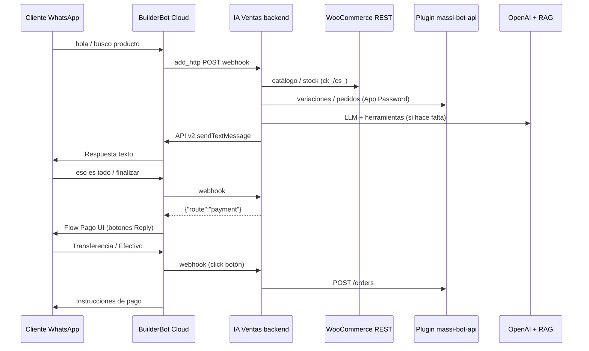
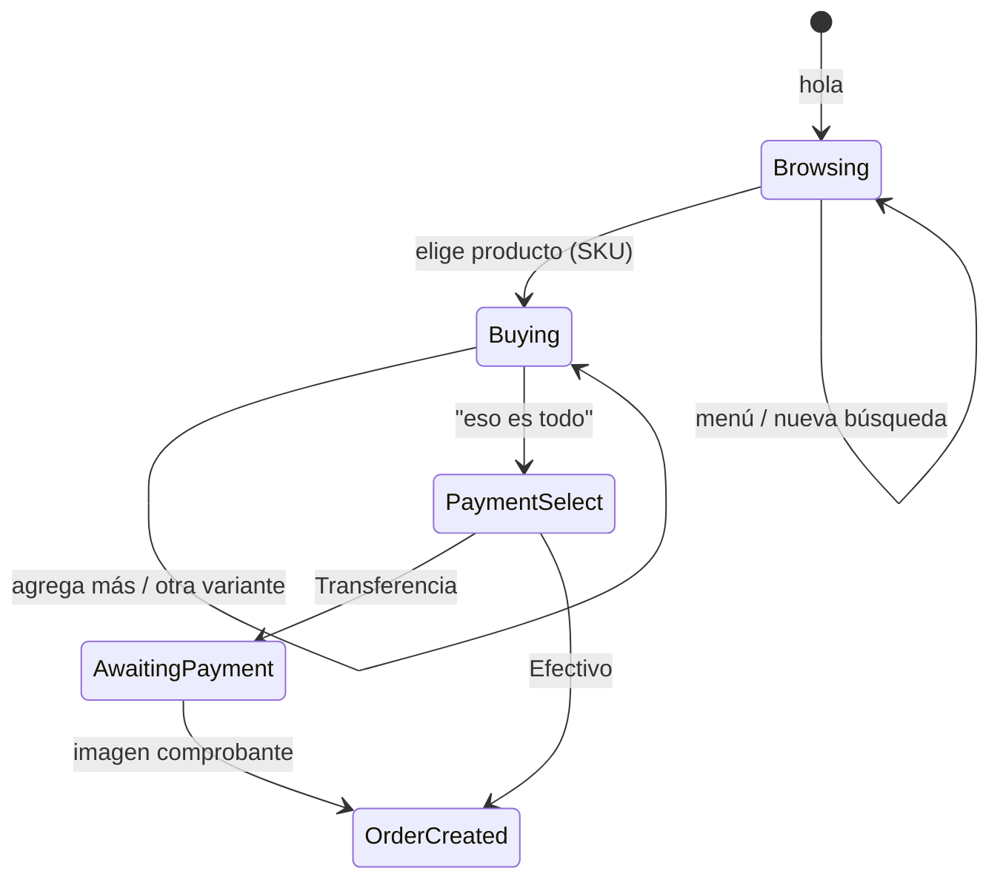

# WhatsApp + MASSI — Integración IA Ventas

> Guía operativa: agente LLM en texto libre + botones BBC **solo** en selección de método de pago.  
> **Catálogo:** cualquier producto WooCommerce (simple o variable) identificado por **SKU**.  
> **Contexto de negocio** (QR en tienda, clientes remotos, formularios WC, tickets, OTP): [`business-flow-massi.md`](./business-flow-massi.md).

---

## Arquitectura



| Componente | Rol |
|------------|-----|
| **BuilderBot Cloud** | WhatsApp, relay webhook (`add_http`), flow **Pago UI** con botones |
| **IA Ventas `sales-agent`** | Agente LLM + atajos deterministas (carrito, SKU); orquesta `payment_select` |
| **WooCommerce REST** (`ck_`/`cs_`) | Búsqueda catálogo, productos simples, fallback stock por SKU |
| **Plugin `massi-bot-api` (WordPress)** | Variaciones enriquecidas, lookup por SKU, pedidos MASSI, tickets, comprobantes |
| **RAG (documentos panel)** | Info del negocio / políticas — **no** sustituye precios del catálogo WC |

### Envío de mensajes (cloud-v2)

| Tipo | Mecanismo |
|------|-----------|
| Texto (hola, productos, carrito, ayuda) | `POST /api/v2/{projectId}/messages` desde IA Ventas |
| Botones de pago | Webhook responde `{ "route": "payment" }` → regla HTTP → flow **IA Ventas — Pago UI** |

**Importante:** la API v2 **no** envía botones en el payload (`buttons` se ignoran). **No** uses `messageMapping` en el relay HTTP (BBC envía literalmente el nombre del campo, p. ej. `"message"` o `"reply"`).

Relay HTTP (`sync-webhook`):

- `avoidResponse: true`
- Regla: `route === "payment"` → flow Pago UI
- Sin `messageMapping`

---

## Modelo de productos (WooCommerce)

Aplica a **cualquier negocio** con catálogo WC, no solo joyería.

| Tipo WC | Comportamiento del agente |
|---------|---------------------------|
| **Simple** | Un SKU, un precio, un stock |
| **Variable** | Producto padre + variaciones (medida, talla, color, modelo, etc.). **Cada variación debe tener SKU único** |
| **Sin SKU** | El agente avisa que falta SKU en la tienda; no puede agregar al carrito de forma fiable |

### Identificador principal: SKU

1. **Búsqueda:** `buscar_productos_tienda` → WC REST + variaciones vía MASSI (si está configurado).
2. **Resolución exacta:** `GET /massi-bot/v1/products/by-sku?sku=...` (preferido) o `GET /wc/v3/products?sku=...`.
3. **Carrito:** cada línea guarda `productId`, `variationId?`, `sku`, `name`, `quantity`, `unitPrice`.
4. **Pedido MASSI:** `line_items` con `product_id` + `variation_id` + `quantity`.

### Atributos de variación reconocidos en texto libre

El backend interpreta hints genéricos (no hardcodeados por categoría):

- Medidas: `45 cm`, `50mm`, `10 gr`
- Tallas: `talla M`, `size L`, `XL`
- Colores: `rojo`, `color azul`, `en negro`
- Modelos: `#3`, `modelo 5`
- Cantidad: `2 unidades`, `x3`

Con **carrito activo**, mensajes cortos como *"otra de 45 cm"*, *"talla M"* o *"en rojo"* resuelven otra variación del **mismo producto padre** que el último ítem del carrito.

---

## Configuración en panel (`/business/woocommerce`)

> **Guía paso a paso (usuario bot, Application Password, plugin, ngrok):** [`woocommerce-setup-massi.md`](./woocommerce-setup-massi.md)

| Campo | Valor |
|-------|--------|
| URL tienda | HTTPS público en prod; en local: ngrok → Local WP (ej. `https://xxxx.ngrok-free.app`) |
| Consumer Key / Secret | Claves REST WooCommerce (`ck_` / `cs_`) |
| Usuario WP (Bot) | Login del usuario bot en WordPress (no email) |
| Application Password | Contraseña de aplicación WP (24 chars), **no** la contraseña de login |

**Probar conexión** valida WC REST + MASSI Bot API (`/ping` + auth).

> **Dev local:** EC2/prod debe alcanzar la URL pública de la tienda. Si usas Local WP + ngrok, mantén ngrok activo; un 502 de nginx indica tienda caída o túnel expirado.

---

## Plugin WordPress `massi-bot-api`

Ubicación local: `Local Sites/{sitio}/.../wp-content/plugins/massi-bot-api/`

| Endpoint | Auth | Uso |
|----------|------|-----|
| `GET /wp-json/massi-bot/v1/ping` | Público | Health check |
| `GET /massi-bot/v1/clients?phone=` | App Password | Perfil cliente |
| `GET /massi-bot/v1/orders?phone=` | App Password | Pedidos recientes |
| `POST /massi-bot/v1/orders` | App Password | Crear pedido + ticket MASSI |
| `POST /massi-bot/v1/orders/{id}/payment-report` | App Password | Comprobante (URL imagen) |
| `GET /massi-bot/v1/products/{id}/variations` | App Password | Variaciones con atributos y SKU |
| `GET /massi-bot/v1/products/by-sku?sku=` | App Password | Producto o variación por SKU exacto |

Auth: header `Authorization: Basic base64(user:application_password)` + capability `massi_bot_access`.

**Sin MASSI Bot API:** el agente puede buscar en WC REST, pero variaciones y pedidos MASSI completos no están disponibles.

---

## Flujo conversacional esperado

### Fases de sesión (`SalesContext`)

| Fase / paso | Significado |
|-------------|-------------|
| `phase: browsing` | Exploración o armando pedido |
| `flowStep: buying` | Carrito con al menos un ítem; cliente puede seguir agregando |
| `flowStep: payment_select` | Carrito cerrado; esperando click en botón de pago |
| `phase: awaiting_payment` | Pedido MASSI creado; esperando comprobante (transferencia) |
| `phase: order_created` | Pedido registrado (efectivo o pago confirmado) |

### Diagrama de conversación (venta típica)



### 1. Saludo (determinista)

| Cliente | Sistema |
|---------|---------|
| `hola`, `menú`, `buenos días` | Texto de bienvenida del negocio (perfil en `/business/settings` o default del tenant) |

Sin botones. El LLM **no** debe repetir un saludo genérico si ya se envió.

### 2. Exploración de catálogo

| Cliente | Sistema |
|---------|---------|
| `¿qué productos tienen?`, `busco zapatos`, `precio del SKU-123` | LLM → `buscar_productos_tienda` → lista con **SKU por variación** |

Prioridad: **WooCommerce**, no documentos RAG, para precios y stock.

### 3. Agregar al carrito

| Cliente | Sistema |
|---------|---------|
| `quiero [producto] [variante]` | Atajo determinista o LLM → resuelve variación → agrega → resumen + *¿Deseas agregar algo más o eso sería todo?* |
| `otra de 45 cm` (con carrito activo) | Misma familia de producto → variación hermana por atributo |
| `quiero agregar una [producto] de 60cm` | **No** confundir con "agregar algo más" vago; se trata como producto concreto |

**Reglas del carrito:**

- Un producto por mensaje en el atajo determinista; el total se acumula.
- Mismo SKU en carrito → incrementa cantidad.
- Variación distinta → nueva línea.

### 4. Finalizar compra (modo link — default)

| Cliente | Sistema |
|---------|---------|
| `eso es todo`, `eso sería todo`, `listo` | Valida stock → mensaje con **URL al formulario WC** + resumen carrito |
| `reenvía el link` / `formulario` | Reenvía la misma URL |

El cliente elige en la **web**: recoger en tienda, domicilio, transferencia o efectivo.

### 4b. Finalizar compra (modo whatsapp — legacy)

| Cliente | Sistema |
|---------|---------|
| `eso es todo` (con `checkoutMode: whatsapp`) | Botones BBC Transferencia / Efectivo |

### 5. Método de pago (botones BBC — determinista)

Flow **IA Ventas — Pago UI**:

| Botón | ID | Acción |
|-------|-----|--------|
| Transferencia | `massi:pay:transfer` | `POST /massi-bot/v1/orders` (`mdp_788`) + datos bancarios |
| Efectivo tienda | `massi:pay:cash` | Pedido + ticket provisional (`mdp_789`) |
| Menú principal | `massi:menu:back` | Cancela selección de pago |

### 6. Comprobante (imagen)

Imagen WhatsApp → webhook → `submitPaymentReport` si hay `massiWooOrderId` en sesión.

### 7. Errores de tienda

Si WooCommerce responde 502/503 (túnel caído, Local WP apagado):

- El agente responde con mensaje amable (no silencio).
- Se conserva el resumen del carrito si existía.
- Reintentos automáticos (×3) en el adapter WC.

---

## Ejemplo E2E (productos variables genéricos)

```
Cliente: hola
Bot:     ¡Bienvenido a [Negocio]! … ¿En qué te podemos ayudar?

Cliente: ¿tienen camisetas?
Bot:     [lista desde WC con SKUs y variantes: S, M, L…]

Cliente: quiero la camiseta básica talla M
Bot:     ¡Listo! Agregué Camiseta Básica - M x1 — $45.000
         Total: $45.000
         ¿Deseas agregar algo más o eso sería todo?

Cliente: otra en talla L
Bot:     ¡Listo! Agregué Camiseta Básica - L x1 …
         Total: $90.000
         ¿Deseas agregar algo más o eso sería todo?

Cliente: eso sería todo
Bot:     [botones Transferencia / Efectivo / Menú]

Cliente: [Transferencia]
Bot:     Pedido #1234 | Ticket ABC | Datos Bre-B…
         Envía captura del comprobante.
```

Misma lógica aplica a joyería (cm), calzado (talla), electrónica (modelo), etc.

---

## BuilderBot Cloud — resumen

> Detalle completo (modo link vs whatsapp, qué tocar en BBC): [`woocommerce-setup-massi.md`](./woocommerce-setup-massi.md) §11.

| Modo checkout | Qué pasa en BBC |
|---------------|-----------------|
| **`link` (default)** | Solo relay + API v2 texto (incluye URL formulario). **No** se dispara flow Pago UI. |
| **`whatsapp` (legacy)** | Webhook `{ "route": "payment" }` → flow **Pago UI** con botones Reply. |

**Sin cambios obligatorios en BBC** al pasar a modo link. Re-sincronizar webhook tras deploy sigue siendo buena práctica.

---

## Configurar botones en BuilderBot Cloud (solo modo `whatsapp`)

Tras **Re-sincronizar webhook** en panel IA Ventas → WhatsApp:

1. Abre [app.builderbot.cloud](https://app.builderbot.cloud) → proyecto del negocio.
2. Flow **IA Ventas — Pago UI** → bloque texto `Perfecto. Elige cómo deseas pagar:`.
3. **Botones interactivos → + Reply** (3 botones, no CTA URL):

| Texto | ID (si el panel lo pide) |
|-------|--------------------------|
| Transferencia | `massi:pay:transfer` |
| Efectivo tienda | `massi:pay:cash` |
| Menú principal | `massi:menu:back` |

4. **Guardar** el bloque en el editor (Reboot **no** guarda cambios).
5. Deploy / Reboot del bot en BBC.

**No tocar** el flow **IA Ventas — Agente** (relay HTTP). Puedes **eliminar** `IA Ventas — Menú UI` si existe; ya no se usa.

Modo **wa-api** (`console.builderbot.app`): botones vía `POST /messages` directo en el adapter.

---

## Backend — archivos clave

| Tema | Archivo |
|------|---------|
| Relay HTTP + reglas BBC | `builderbot/infrastructure/BuilderBotCloudWebhookRelay.ts` |
| Flow UI de pago (MCP) | `builderbot/infrastructure/BuilderBotCloudUiFlowsRelay.ts` |
| Respuesta webhook `{ route }` | `builderbot/domain/BbcWebhookAgentResponse.ts` |
| Webhook síncrono | `builderbot/presentation/controllers/WebhookController.ts` |
| Envío texto API v2 | `builderbot/infrastructure/BuilderBotCloudV2Adapter.ts` |
| Parser clicks de botones | `builderbot/application/services/BuilderBotWebhookParser.ts` |
| Paso pago + botones | `sales-agent/application/services/ConversationFlowService.ts` |
| Agente + carrito + SKU | `sales-agent/application/services/SalesAgentService.ts` |
| Resolución producto/variante | `sales-agent/application/services/SalesAgentToolsHandler.ts` |
| Utilidades selección genérica | `sales-agent/domain/productSelection.utils.ts` |
| IDs de botones | `sales-agent/domain/whatsappFlow.constants.ts` |
| Adapter MASSI REST | `massi-bot/infrastructure/MassiBotRestAdapter.ts` |
| Adapter WooCommerce REST | `woocommerce/infrastructure/WooCommerceRestAdapter.ts` |

---

## Deploy producción (EC2)

```bash
cd ~/IA-Ventas-B
git pull origin main
npm run build
pm2 restart ia-ventas
```

Luego en panel → WhatsApp → **Re-sincronizar webhook**.

---

## Prueba manual (checklist)

- [ ] MASSI Bot + WC conectados en panel
- [ ] WhatsApp escaneado (cloud-v2, `APP_PUBLIC_URL` público)
- [ ] Tienda WC accesible desde el servidor (ngrok estable si es local)
- [ ] **Re-sincronizar webhook** tras cada deploy que toque relay/BBC
- [ ] **hola** → un mensaje de texto (sin botones)
- [ ] Buscar producto → listado con SKUs de variaciones
- [ ] Elegir variante → carrito + *¿algo más o eso es todo?*
- [ ] Segunda variante del mismo producto (*otra de X*) → suma al carrito
- [ ] **eso sería todo** → botones Transferencia / Efectivo / Menú
- [ ] **Transferencia** → datos bancarios → imagen comprobante
- [ ] Producto **simple** y **variable** (cualquier categoría WC)

---

## Pendiente (roadmap)

Ver tabla completa y prioridades en [`business-flow-massi.md`](./business-flow-massi.md) §5.

| Item | Resumen |
|------|---------|
| Recoger vs domicilio | `delivery_type: delivery` + datos envío (hoy solo `pickup`) |
| Formulario WC / link checkout | Tras carrito; formularios viven en WordPress |
| Perfil cliente por teléfono | `GET /clients?phone=` — adapter listo, agente no usa |
| Webhook estado → WhatsApp | `_massi_operational_status`; hoy solo email WC |
| OTP Mi cuenta vía WhatsApp | Misma línea BuilderBot; coordinar con plugin WP |
| Listas WhatsApp variaciones | Elegir variante sin texto libre |
| Tests E2E automatizados | — |

---

*Última actualización: 24 julio 2026 — flujo carrito + SKU genérico (cualquier catálogo WC), texto vía API v2, botones solo en pago.*
