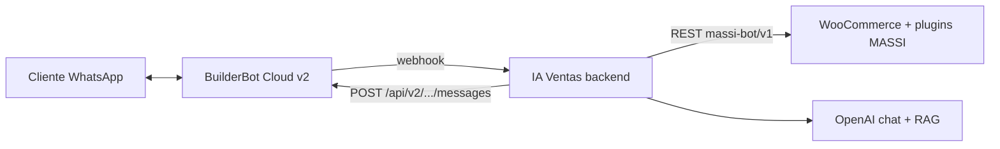

# WhatsApp + MASSI — Integración IA Ventas

> Guía operativa: flujo híbrido (botones deterministas + agente LLM) con WooCommerce MASSI y BuilderBot Cloud v2.

---

## Arquitectura

| Componente | Rol |
|------------|-----|
| **BuilderBot Cloud** | Mensajería WhatsApp (QR, relay webhook, envío texto/botones) |
| **IA Ventas `sales-agent`** | Orquestador: menú, pago, comprobantes, fallback LLM |
| **Plugin `massi-bot-api` (WordPress)** | Pedidos MASSI, tickets, comprobantes → Drive/MDP |
| **WooCommerce REST** | Catálogo, stock, credenciales `ck_`/`cs_` por tenant |

---

## Configuración en panel (`/business/woocommerce`)

| Campo | Valor |
|-------|--------|
| URL tienda | `https://massijoyeria.local` (HTTPS obligatorio en local) |
| Consumer Key / Secret | Claves REST WooCommerce |
| Usuario WP (Bot) | Login del usuario bot en WordPress (no email) |
| Application Password | Contraseña de aplicación WP (24 chars), **no** la contraseña de login |

**Probar conexión** valida WC + MASSI Bot API. Si el bot aún no está guardado, puedes pasar credenciales en el body del test y se persisten al OK.

---

## Plugin WordPress `massi-bot-api`

Ubicación local: `Local Sites/massijoyeria/.../wp-content/plugins/massi-bot-api/`

| Endpoint | Auth | Uso |
|----------|------|-----|
| `GET /wp-json/massi-bot/v1/ping` | Público | Health check |
| `GET /massi-bot/v1/clients?phone=` | App Password | Perfil cliente |
| `GET /massi-bot/v1/orders?phone=` | App Password | Pedidos recientes |
| `POST /massi-bot/v1/orders` | App Password | Crear pedido + ticket MASSI |
| `POST /massi-bot/v1/orders/{id}/payment-report` | App Password | Comprobante (URL imagen) |
| `GET /massi-bot/v1/products/{id}/variations` | App Password | Variaciones (balines, promos) |

Auth: header `Authorization: Basic base64(user:application_password)` + capability `massi_bot_access`.

---

## Flujo WhatsApp (agente LLM + botones solo en pago)

### Conversación general

Saludos, búsqueda de productos, pedidos y ayuda los resuelve el **agente LLM** en texto libre (sin botones de menú).

### Compra con MASSI conectado

1. Cliente busca producto (texto libre → LLM + herramientas WC/RAG).
2. LLM llama `preparar_pago` → valida stock, guarda carrito, **no crea pedido aún**.
3. Backend responde `route: "payment"` → BBC muestra botones: **Transferencia** | **Efectivo tienda** | **Menú principal**.
4. Click en método → `POST /massi-bot/v1/orders` con `mdp_788` (Bre-B) o `mdp_789` (efectivo).
5. **Transferencia:** instrucciones bancarias + espera comprobante (imagen).
6. **Efectivo:** ticket provisional + indicación de ir a la joyería.

### Comprobante de pago

Imagen WhatsApp → webhook → `submitPaymentReport` en MASSI Bot API (si hay `massiWooOrderId` en sesión).

---

## Backend — archivos clave

| Tema | Archivo |
|------|---------|
| Envío botones/listas BBC v2 | `builderbot/infrastructure/BuilderBotCloudV2Adapter.ts` |
| Parser clicks de botones | `builderbot/application/services/BuilderBotWebhookParser.ts` |
| Orquestador de menú/pago | `sales-agent/application/services/ConversationFlowService.ts` |
| IDs y labels de botones | `sales-agent/domain/whatsappFlow.constants.ts` |
| Agente + herramientas | `sales-agent/application/services/SalesAgentService.ts` |
| Adapter MASSI REST | `massi-bot/infrastructure/MassiBotRestAdapter.ts` |
| Config WC + bot por tenant | `woocommerce/.../WooCommerceUseCases.ts` |

### Envío de botones (BuilderBot Cloud v2)

La API outbound `POST /api/v2/{projectId}/messages` **solo envía texto**; ignora `buttons` e `interactive` (documentado en BBC MCP v2.1).

En **cloud-v2** los botones de pago se envían vía el flow BBC provisionado al sincronizar webhook:

| Flow BBC | Ruta HTTP | Botones |
|----------|-----------|---------|
| `IA Ventas — Pago UI` | `route: "payment"` | Transferencia · Efectivo tienda · Menú principal |

El resto de mensajes usan `route: "text"` y el agente responde en texto plano.

El webhook responde de forma **síncrona** `{ "route": "payment"|"text", "message": "..." }`.

**Configuración única en panel BBC:** el MCP no persiste `options.buttons`. Tras **Re-sincronizar webhook**, abre el flow **IA Ventas — Pago UI** en [app.builderbot.cloud](https://app.builderbot.cloud) y añade botones **Reply** al `add_text`:

| Botón | ID (si el panel lo pide) |
|-------|--------------------------|
| Transferencia | `massi:pay:transfer` |
| Efectivo tienda | `massi:pay:cash` |
| Menú principal | `massi:menu:back` |

Puedes **eliminar** el flow `IA Ventas — Menú UI` si lo creaste antes; ya no se usa.

Modo **wa-api** (`console.builderbot.app`) sí soporta botones en `POST /messages` y el adapter los envía directo.

### Respuesta de botón entrante (webhook)

El parser acepta `interactive.button_reply`, `interactive.list_reply` y mapea `title`/`id` al texto del mensaje.

---

## Prueba manual (checklist)

- [ ] Backend `npm run dev`, MASSI Bot + WC conectados en panel
- [ ] WhatsApp escaneado (BuilderBot cloud-v2, `APP_PUBLIC_URL` público en prod)
- [ ] Escribir **hola** → 3 botones visibles
- [ ] **Comprar** → buscar producto → confirmar → botones de pago
- [ ] **Transferencia** → datos bancarios → enviar imagen comprobante
- [ ] **Mi pedido** → lista pedidos del teléfono
- [ ] Escribir **menú** en cualquier momento → vuelve al menú (excepto en `awaiting_payment`)

---

## Pendiente (roadmap)

- Listas WhatsApp para **variaciones** de productos variables
- Webhook WC → notificación WhatsApp en cambios de `_massi_operational_status`
- OTP registro usuario WP vía BuilderBot
- Tests E2E automatizados

---

*Última actualización: julio 2026 — botones WhatsApp, MASSI Bot API, flujo pago diferido.*
