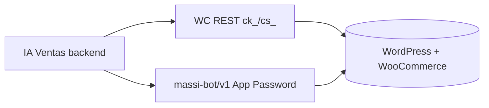

# WooCommerce + MASSI — Guía de configuración

> Checklist para conectar la tienda WordPress/WooCommerce con **IA Ventas** (agente WhatsApp).  
> **Complementa:** [`whatsapp-massi.md`](./whatsapp-massi.md) (integración BBC) · [`business-flow-massi.md`](./business-flow-massi.md) (lógica de negocio).

---

## 1. Resumen: dos APIs hacia la misma tienda

IA Ventas usa **dos autenticaciones distintas** hacia WordPress:

| API | Credenciales | Base URL | Uso en el agente |
|-----|--------------|----------|------------------|
| **WooCommerce REST** | Consumer Key + Consumer Secret (`ck_` / `cs_`) | `{storeUrl}/wp-json/wc/v3` | Catálogo, búsqueda, stock, productos simples |
| **MASSI Bot API** (plugin WP) | Usuario WP + **Application Password** | `{storeUrl}/wp-json/massi-bot/v1` | Variaciones, SKU exacto, pedidos, tickets, comprobantes |

Ambas se guardan en el panel **`/business/woocommerce`** y en DynamoDB por tenant (nunca en el repo).



---

## 2. Prerrequisitos en WordPress

| Requisito | Notas |
|-----------|--------|
| **WooCommerce** instalado y activo | Obligatorio |
| **HTTPS** en la URL de tienda | Obligatorio en prod; local: `https://massijoyeria.local` |
| Plugin **`massi-bot-api`** | En `wp-content/plugins/massi-bot-api/` |
| Plugins MASSI de negocio | El Bot API envuelve lógica de tickets/pagos (`massi-tickets`, `woo-massi`, `motor-de-pagos`, según instalación del sitio) |
| Productos con **SKU** | Cada variación variable debe tener SKU único |

---

## 3. Activar plugin `massi-bot-api`

1. WordPress Admin → **Plugins** → activar **MASSI Bot API**.
2. Al activar, el plugin automáticamente:
   - Crea el rol **`massi_bot_service`** (“MASSI Bot Service”) con capability **`massi_bot_access`**
   - Añade **`massi_bot_access`** al rol **Administrator**
3. Verificar que WooCommerce esté activo (el plugin no carga rutas REST sin WC).

**Endpoints expuestos** (`/wp-json/massi-bot/v1/`):

| Ruta | Auth | Uso |
|------|------|-----|
| `GET /ping` | Público | Health check |
| `GET /clients?phone=` | App Password | Perfil cliente por teléfono |
| `GET /orders?phone=` | App Password | Pedidos recientes |
| `POST /orders` | App Password | Crear pedido MASSI |
| `POST /orders/{id}/payment-report` | App Password | Comprobante de pago |
| `GET /products/{id}/variations` | App Password | Variaciones con atributos |
| `GET /products/by-sku?sku=` | App Password | Producto o variación por SKU |

---

## 4. Crear usuario bot + Application Password

### 4.1 Usuario WordPress

1. **Usuarios → Añadir nuevo**
2. **Nombre de usuario:** ej. `iaventas-bot` (este valor va al panel — **no** uses el email)
3. **Rol:** `MASSI Bot Service` (`massi_bot_service`)  
   - Alternativa: Administrator (ya tiene `massi_bot_access` tras activar el plugin)
4. Guardar usuario

### 4.2 Application Password

1. Editar el perfil del usuario bot (o el tuyo si usas admin)
2. Bajar a **Contraseñas de aplicación** (WordPress 5.6+)
3. Nombre: ej. `IA Ventas`
4. **Crear** → copiar la contraseña de **24 caracteres** (solo se muestra una vez)

> **Importante:** en el panel IA Ventas va la **Application Password**, **no** la contraseña de login de WordPress.  
> El backend **elimina espacios** al guardar/probar (WordPress muestra la clave con espacios cada 4 chars).

### 4.3 Auth que usa el backend

```http
GET https://{tienda}/wp-json/massi-bot/v1/clients?phone=573000000000
Authorization: Basic base64({usuario}:{application_password})
```

El usuario debe tener capability `massi_bot_access` (rol `massi_bot_service` o admin).

---

## 5. Claves REST WooCommerce

1. WooCommerce → **Ajustes → Avanzado → REST API**
2. **Añadir clave**
3. Descripción: ej. `IA Ventas`
4. Usuario: admin o usuario con permisos WC
5. Permisos: **Lectura/Escritura** (según operaciones del tenant)
6. Copiar **Consumer Key** (`ck_…`) y **Consumer Secret** (`cs_…`)

En local, las claves se envían por **query string** (`consumer_key` / `consumer_secret`) porque Local WP a veces no reenvía `Authorization` — el adapter IA Ventas ya lo contempla.

---

## 6. Panel IA Ventas (`/business/woocommerce`)

| Campo | Valor ejemplo | Notas |
|-------|---------------|--------|
| **URL de la tienda** | `https://xxxx.ngrok-free.app` (prod/dev) o `https://massijoyeria.local` (solo local) | Debe ser alcanzable desde el **servidor** donde corre IA Ventas (EC2) |
| **Consumer Key** | `ck_…` | REST WC |
| **Consumer Secret** | `cs_…` | REST WC |
| **Usuario WP (Bot)** | `iaventas-bot` | Login WP, no email |
| **Application Password** | 24 chars | No la contraseña de login; espacios opcionales al pegar |

Pulsar **Guardar** y luego **Probar conexión** (las credenciales deben estar persistidas en DynamoDB antes de probar). Resultado esperado:

- `WooCommerce: conectado`
- `MASSI Bot API: conectado`
- Se detectan y guardan **`checkoutPagePath`** (ej. `/finalizar-compra/`) y **`shopPagePath`** (ej. `/tienda/`) para links del agente WhatsApp

### Errores comunes al probar

| Mensaje | Causa |
|---------|--------|
| WC OK, MASSI auth failed | Usuario o Application Password incorrectos; en hosting compartido ver §13 (header `Authorization`) |
| WC OK, faltan credenciales bot | No guardaste usuario + App Password |
| 502 / timeout | Tienda caída, ngrok expirado, URL incorrecta |
| Productos sin variaciones | MASSI Bot API no configurada (solo afecta variaciones) |

---

## 7. Configuración adicional (`/business/settings`)

| Campo | Uso |
|-------|-----|
| **URL formulario de compra** (`checkoutFormUrl`) | Opcional. Si vacío → `{storeUrl}{checkoutPagePath}` (auto-detect, ej. `/finalizar-compra/`) |
| **Modo cierre de compra** (`checkoutMode`) | `link` (default): enlace al formulario WC · `whatsapp`: botones pago en chat (legacy) |
| **Datos bancarios** | Solo relevante en modo `whatsapp` o mensajes informativos |

---

## 8. Desarrollo local (Local WP + ngrok)

Cuando IA Ventas corre en **EC2** y la tienda en **Local WP**:

```bash
ngrok http 10004 --host-header=massijoyeria.local
```

1. Copiar URL pública ngrok (ej. `https://abc123.ngrok-free.app`)
2. Panel → WooCommerce → **URL de la tienda** = esa URL ngrok
3. Mantener ngrok activo mientras pruebas; si cae → **502** en el agente

---

## 9. Catálogo: SKUs obligatorios

| Tipo producto | Regla |
|---------------|--------|
| Simple | Un SKU por producto |
| Variable | **Un SKU por variación** (45 cm, 50 cm, talla M, etc.) |

Sin SKU el agente no puede resolver stock ni armar el link de checkout con `items=SKU:qty`.

> **Solo se venden productos publicados en WC.** Si el cliente pide algo que no está en la tienda (ej. anillos no publicados), el agente avisa y no lo inventa.

---

## 10. Checklist de verificación

- [ ] WooCommerce activo
- [ ] Plugin `massi-bot-api` activo (rol `massi_bot_service` creado)
- [ ] Usuario bot creado (`iaventas-bot` o similar)
- [ ] Application Password generada y guardada en panel (**Guardar** antes de **Probar conexión**)
- [ ] REST API keys `ck_` / `cs_` creadas y guardadas
- [ ] URL tienda accesible desde el servidor IA Ventas
- [ ] **Probar conexión** → WC + MASSI OK
- [ ] Productos/variaciones con SKU en la tienda
- [ ] (Opcional) `checkoutFormUrl` si el formulario MASSI no es `/finalizar-compra/` ni `/checkout/`

---

## 11. BuilderBot Cloud — ¿hay cambios?

Con el flujo de negocio actual (**modo `link`**, default) y los cambios recientes del agente:

### 11.1 Lo que **no cambia** en BuilderBot

| Componente | Sigue igual |
|------------|-------------|
| Flow **IA Ventas — Agente** | Relay HTTP `add_http` → webhook IA Ventas |
| `avoidResponse: true` | El texto lo envía IA Ventas vía **API v2** |
| QR / emparejar WhatsApp | Panel `/business/whatsapp` |
| **Re-sincronizar webhook** | Tras deploy que toque relay o flows |
| Sin `messageMapping` | Obligatorio — no activar en BBC |

### 11.2 Lo que **cambia** con modo `link` (default)

| Antes (whatsapp) | Ahora (link) |
|------------------|--------------|
| Tras “eso es todo” → webhook responde `{ "route": "payment" }` | Webhook responde `{ "route": "none" }` |
| BBC muestra flow **Pago UI** con botones | IA Ventas envía **texto + URL** del formulario WC vía API v2 |
| Pedido se crea en chat (`POST /massi-bot/v1/orders`) | Cliente completa **formulario en WooCommerce** |
| Comprobante por imagen en WhatsApp | Validación y ticket en **panel WC** (+ email) |

**Conclusión:** **no hay cambios obligatorios en BuilderBot** para el flujo link. El relay y API v2 siguen siendo el canal principal.

### 11.3 Flow **IA Ventas — Pago UI** (botones)

| Modo | ¿Necesario en BBC? |
|------|---------------------|
| `checkoutMode: link` (default) | **No** se usa en el flujo normal. Puede quedar provisionado sin afectar. |
| `checkoutMode: whatsapp` (legacy) | **Sí** — configurar 3 botones Reply manualmente en BBC |

Botones Reply (solo modo whatsapp):

| Texto | ID |
|-------|-----|
| Transferencia | `massi:pay:transfer` |
| Efectivo tienda | `massi:pay:cash` |
| Menú principal | `massi:menu:back` |

Pasos: panel [app.builderbot.cloud](https://app.builderbot.cloud) → flow **IA Ventas — Pago UI** → bloque texto → + Reply × 3 → **Guardar** → Reboot.

### 11.4 Limpieza opcional en BBC

- **Eliminar** flow **IA Ventas — Menú UI** si existe (ya no se usa).
- **No tocar** flow **IA Ventas — Agente** (relay HTTP).
- Flow **Pago UI**: dejar si puedes volver a modo `whatsapp`; no es necesario borrarlo en modo `link`.

### 11.5 Acciones recomendadas tras deploy

1. `git pull` + `npm run build` + `pm2 restart` en EC2
2. Panel → WhatsApp → **Re-sincronizar webhook** (idempotente)
3. Verificar en BBC que el relay apunta a `{APP_PUBLIC_URL}/api/v1/webhooks/builderbot/{tenantId}`
4. Probar: hola → **qué productos tienen** (solo WC) → carrito → **dos productos en un mensaje** → quitar/corregir → “finalizar con la compra” → **link con items=SKU:qty**

### 11.6 Roadmap BuilderBot (no implementado)

| Feature | BBC / IA Ventas |
|---------|-----------------|
| OTP login Mi cuenta → WhatsApp | Enviar OTP desde misma línea (API v2) |
| Notificación “pedido listo” | API v2 proactiva al cambiar estado WC |
| Botón CTA URL “Abrir formulario” | Opcional en flow; hoy el link va en texto plano |

---

## 12. Plugin WP: pre-carga de carrito desde link

**Implementado** en `massi-bot-api` → `class-massi-bot-checkout-link.php`.

Al abrir:

```
https://{tienda}/finalizar-compra/?phone=573103534207&source=whatsapp&public_store=https%3A%2F%2F{tienda}&items=SKU-A:1,SKU-B:2
```

El plugin (`class-massi-bot-checkout-link.php`):

1. Vacía el carrito WC y agrega productos/variaciones por **SKU**
2. Guarda el teléfono en sesión → pre-rellena `billing_phone` en checkout (formulario woo-massi)
3. No duplica carga si se recarga la misma URL (firma en sesión)
4. Evita redirect a carrito vacío; soporta `public_store` para ngrok (`class-massi-bot-ngrok-url.php`)

**Requisito:** SKUs en variaciones; ruta `/finalizar-compra/` (MASSI) o configurar `checkoutFormUrl`.

---

## 13. Instalar plugin en producción (zip)

IA Ventas **no** instala el plugin en WordPress; se sube manualmente.

| Artefacto | Ubicación |
|-----------|-----------|
| Zip listo para WP | `dist/massi-bot-api-ia-ventas.zip` |
| Script empaquetado | `dist/build-plugin-zip.ps1` (rutas `/`, compatible Linux) |
| Instrucciones | `dist/INSTALAR-PLUGIN-WORDPRESS.txt` |

Pasos:

1. WordPress Admin → **Plugins → Añadir nuevo → Subir plugin** → elegir el zip
2. **Activar** MASSI Bot API
3. Crear usuario bot + Application Password (§4)
4. Panel IA Ventas → credenciales → **Guardar** → **Probar conexión**

### Fix Authorization en hosting

Algunos hostings (SiteGround, etc.) **no reenvían** el header `Authorization` a PHP. El plugin incluye `class-massi-bot-auth.php` → `fix_authorization_header()` que reconstruye `HTTP_AUTHORIZATION` desde `REDIRECT_HTTP_AUTHORIZATION` o `PHP_AUTH_USER`/`PHP_AUTH_PW`.

Si MASSI falla con credenciales correctas:

1. Verificar que el zip incluye `includes/class-massi-bot-auth.php`
2. Probar `GET /wp-json/massi-bot/v1/ping` (público) y luego `/clients?phone=…` con Basic auth

---

## 14. Handoff producción (MASSI Joyería)

Referencia verificada jul 2026:

| Item | Valor |
|------|--------|
| Plataforma IA Ventas | `https://ventas.nedi.info` |
| Tienda WC | `https://massijoyeria.com` |
| Checkout link | `/finalizar-compra/?phone=…&items=SKU:qty` |
| Plugin | `massi-bot-api` manual en WP (zip §13) |
| Panel | `/business/woocommerce` — WC + MASSI Bot API conectados |

Deploy backend tras cambios de agente:

```bash
cd ~/IA-Ventas-B && git pull && cd backend && npm run build && pm2 restart all
```

---

*Última actualización: 30 julio 2026 — shopPagePath `/tienda/`, saludo discovery, RAG→SKU, catálogo por link.*
