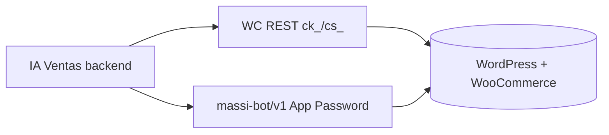

# WooCommerce + MASSI — Guía de configuración

> Checklist para conectar la tienda WordPress/WooCommerce con **IA Ventas** (agente WhatsApp).  
> **Complementa:** [`whatsapp-massi.md`](./whatsapp-massi.md) (integración BBC) · [`business-flow-massi.md`](./business-flow-massi.md) (lógica de negocio).

---

## 1. Resumen: dos APIs hacia la misma tienda

IA Ventas usa **dos autenticaciones distintas** hacia WordPress:

| API | Credenciales | Base URL | Uso en el agente |
|-----|--------------|----------|------------------|
| **WooCommerce REST** | Consumer Key + Consumer Secret (`ck_` / `cs_`) | `{storeUrl}/wp-json/wc/v3` | Catálogo, búsqueda, stock, productos simples |
| **MASSI Bot API** (plugin WP) | Usuario WP + **Application Password** | `{storeUrl}/wp-json/massi-bot/v1` | Variaciones, SKU exacto, pedidos, tickets, comprobantes |

Ambas se guardan en el panel **`/business/woocommerce`** y en DynamoDB por tenant (nunca en el repo).



---

## 2. Prerrequisitos en WordPress

| Requisito | Notas |
|-----------|--------|
| **WooCommerce** instalado y activo | Obligatorio |
| **HTTPS** en la URL de tienda | Obligatorio en prod; local: `https://massijoyeria.local` |
| Plugin **`massi-bot-api`** | En `wp-content/plugins/massi-bot-api/` |
| Plugins MASSI de negocio | El Bot API envuelve lógica de tickets/pagos (`massi-tickets`, `woo-massi`, `motor-de-pagos`, según instalación del sitio) |
| Productos con **SKU** | Cada variación variable debe tener SKU único |

---

## 3. Activar plugin `massi-bot-api`

1. WordPress Admin → **Plugins** → activar **MASSI Bot API**.
2. Al activar, el plugin automáticamente:
   - Crea el rol **`massi_bot_service`** (“MASSI Bot Service”) con capability **`massi_bot_access`**
   - Añade **`massi_bot_access`** al rol **Administrator**
3. Verificar que WooCommerce esté activo (el plugin no carga rutas REST sin WC).

**Endpoints expuestos** (`/wp-json/massi-bot/v1/`):

| Ruta | Auth | Uso |
|------|------|-----|
| `GET /ping` | Público | Health check |
| `GET /clients?phone=` | App Password | Perfil cliente por teléfono |
| `GET /orders?phone=` | App Password | Pedidos recientes |
| `POST /orders` | App Password | Crear pedido MASSI |
| `POST /orders/{id}/payment-report` | App Password | Comprobante de pago |
| `GET /products/{id}/variations` | App Password | Variaciones con atributos |
| `GET /products/by-sku?sku=` | App Password | Producto o variación por SKU |

---

## 4. Crear usuario bot + Application Password

### 4.1 Usuario WordPress

1. **Usuarios → Añadir nuevo**
2. **Nombre de usuario:** ej. `iaventas-bot` (este valor va al panel — **no** uses el email)
3. **Rol:** `MASSI Bot Service` (`massi_bot_service`)  
   - Alternativa: Administrator (ya tiene `massi_bot_access` tras activar el plugin)
4. Guardar usuario

### 4.2 Application Password

1. Editar el perfil del usuario bot (o el tuyo si usas admin)
2. Bajar a **Contraseñas de aplicación** (WordPress 5.6+)
3. Nombre: ej. `IA Ventas`
4. **Crear** → copiar la contraseña de **24 caracteres** (solo se muestra una vez)

> **Importante:** en el panel IA Ventas va la **Application Password**, **no** la contraseña de login de WordPress.  
> El backend **elimina espacios** al guardar/probar (WordPress muestra la clave con espacios cada 4 chars).

### 4.3 Auth que usa el backend

```http
GET https://{tienda}/wp-json/massi-bot/v1/clients?phone=573000000000
Authorization: Basic base64({usuario}:{application_password})
```

El usuario debe tener capability `massi_bot_access` (rol `massi_bot_service` o admin).

---

## 5. Claves REST WooCommerce

1. WooCommerce → **Ajustes → Avanzado → REST API**
2. **Añadir clave**
3. Descripción: ej. `IA Ventas`
4. Usuario: admin o usuario con permisos WC
5. Permisos: **Lectura/Escritura** (según operaciones del tenant)
6. Copiar **Consumer Key** (`ck_…`) y **Consumer Secret** (`cs_…`)

En local, las claves se envían por **query string** (`consumer_key` / `consumer_secret`) porque Local WP a veces no reenvía `Authorization` — el adapter IA Ventas ya lo contempla.

---

## 6. Panel IA Ventas (`/business/woocommerce`)

| Campo | Valor ejemplo | Notas |
|-------|---------------|--------|
| **URL de la tienda** | `https://xxxx.ngrok-free.app` (prod/dev) o `https://massijoyeria.local` (solo local) | Debe ser alcanzable desde el **servidor** donde corre IA Ventas (EC2) |
| **Consumer Key** | `ck_…` | REST WC |
| **Consumer Secret** | `cs_…` | REST WC |
| **Usuario WP (Bot)** | `iaventas-bot` | Login WP, no email |
| **Application Password** | 24 chars | No la contraseña de login; espacios opcionales al pegar |

Pulsar **Guardar** y luego **Probar conexión** (las credenciales deben estar persistidas en DynamoDB antes de probar). Resultado esperado:

- `WooCommerce: conectado`
- `MASSI Bot API: conectado`
- Se detectan y guardan **`checkoutPagePath`** (ej. `/finalizar-compra/`) y **`shopPagePath`** (ej. `/tienda/`) para links del agente WhatsApp

### Errores comunes al probar

| Mensaje | Causa |
|---------|--------|
| WC OK, MASSI auth failed | Usuario o Application Password incorrectos; en hosting compartido ver §13 (header `Authorization`) |
| WC OK, faltan credenciales bot | No guardaste usuario + App Password |
| 502 / timeout | Tienda caída, ngrok expirado, URL incorrecta |
| Productos sin variaciones | MASSI Bot API no configurada (solo afecta variaciones) |

---

## 7. Configuración adicional (`/business/settings`)

| Campo | Uso |
|-------|-----|
| **URL formulario de compra** (`checkoutFormUrl`) | Opcional. Si vacío → `{storeUrl}{checkoutPagePath}` (auto-detect, ej. `/finalizar-compra/`) |
| **Modo cierre de compra** (`checkoutMode`) | `link` (default): enlace al formulario WC · `whatsapp`: botones pago en chat (legacy) |
| **Datos bancarios** | Solo relevante en modo `whatsapp` o mensajes informativos |

---

## 8. Desarrollo local (Local WP + ngrok)

Cuando IA Ventas corre en **EC2** y la tienda en **Local WP**:

```bash
ngrok http 10004 --host-header=massijoyeria.local
```

1. Copiar URL pública ngrok (ej. `https://abc123.ngrok-free.app`)
2. Panel → WooCommerce → **URL de la tienda** = esa URL ngrok
3. Mantener ngrok activo mientras pruebas; si cae → **502** en el agente

---

## 9. Catálogo: SKUs obligatorios

| Tipo producto | Regla |
|---------------|--------|
| Simple | Un SKU por producto |
| Variable | **Un SKU por variación** (45 cm, 50 cm, talla M, etc.) |

Sin SKU el agente no puede resolver stock ni armar el link de checkout con `items=SKU:qty`.

> **Solo se venden productos publicados en WC.** Si el cliente pide un tipo que no está en la tienda (ej. *tienen anillos?* sin anillos publicados), el agente **consulta**, avisa y **no** cae al «necesito el ID» genérico. El listado anterior sigue válido para elegir por letra o ID.

### 9.2 Productos a granel (balines / `woo-massi`)

Algunos productos simples (SKU tipo `BAL-10DA`) no se venden como `cantidad × precio unitario`. El plugin **`woo-massi`** guarda 4 paquetes (x10, x5, x2, x1) con precio propio y, en la ficha, arma cualquier cantidad N con la combinación más barata.

El agente WhatsApp replica ese cálculo: cotiza, espera confirmación y el carrito de WhatsApp guarda **una línea por paquete** (precio del paquete, no N × unitario).

**Link de checkout:** el backend envía paquetes explícitos en `items`, no solo unidades totales:

```
items=BLL5AM005x10:1,BLL5AM005x5:1,DJVMIL004:1
```

Formato: `SKUxunidadesDelPaquete:cantidadDePaquetes` (coma entre ítems). Productos sin paquetes: `SKU:qty`. **No usar `~`:** WhatsApp lo tacha (`--`) y Hostinger a veces deja `%7E`. El plugin ≥ **1.3.18** acepta `x`, `~`, `%7E` y `--`.

En WordPress, **MASSI Bot API ≥ 1.3.18** (`class-massi-bot-pack-pricing.php`) intenta woo-massi nativo y, si falla (loopback Hostinger / producto «no comprable»), agrega cada línea de paquete con claves `wm_promo_*` y precio de paquete. No usa solo meta `massi_bot_*` — eso provocaba «Paquete X 0».

Ejemplo 18 balines `BAL-10DA`: x10 ($1.720.000) + x5 ($870.000) + x2 ($355.000) + x1 ($180.000) = **$3.125.000**, no 18 × $180.000.

### 9.1 Higiene del catálogo (importante con cientos de productos)

El agente identifica productos por el **nombre**, la **categoría** y las **etiquetas**. Con
catálogos grandes estas convenciones determinan si acierta o pide elegir:

| Convención | Por qué |
|------------|---------|
| El nombre empieza por el **tipo de producto** ("Dije …", "Herraje …", "Topos …") | De ahí sale la familia que reconoce el agente en *«tienen dijes»* |
| Palabras separadas por **espacios**, no guiones | `Balín-Diamantado-#6-Oro` se lee como una sola palabra; `Balín Diamantado #6 Oro` se indexa bien |
| **Un solo nombre de atributo** para la talla (`Talla` o `Tamaño`, no ambos ni `TAMAÑO`) | Nombres mezclados dificultan filtrar variaciones |
| El **peso va en su propio campo**, no dentro de la talla (`11 1/2 · 3.36 g`) | El valor de talla debe ser solo la talla |
| Toda variación con **SKU** | Sin SKU no entra al carrito ni al link de checkout |
| Toda categoría **coherente con el nombre** | Un "Balín Liso" en la categoría "Balín Diamantado" genera coincidencias ambiguas |
| Sin **nombres duplicados** exactos | El agente no puede distinguirlos y pide elegir |
| Sin productos en **"Sin categorizar"** | Pierden la familia y solo se encuentran por nombre |

Para auditar el catálogo y generar el `.txt` del RAG en un paso:

```bash
cd backend
npm run catalog:txt -- --store https://mitienda.com --key ck_xxx --secret cs_xxx --out catalogo.txt
```

El informe de inconsistencias sale por **stderr**; el `.txt` se sube en `/business/documents`.

---

## 10. Checklist de verificación

- [ ] WooCommerce activo
- [ ] Plugin `massi-bot-api` activo (rol `massi_bot_service` creado)
- [ ] Usuario bot creado (`iaventas-bot` o similar)
- [ ] Application Password generada y guardada en panel (**Guardar** antes de **Probar conexión**)
- [ ] REST API keys `ck_` / `cs_` creadas y guardadas
- [ ] URL tienda accesible desde el servidor IA Ventas
- [ ] **Probar conexión** → WC + MASSI OK
- [ ] Productos/variaciones con SKU en la tienda
- [ ] (Opcional) `checkoutFormUrl` si el formulario MASSI no es `/finalizar-compra/` ni `/checkout/`

---

## 11. BuilderBot Cloud — ¿hay cambios?

Con el flujo de negocio actual (**modo `link`**, default) y los cambios recientes del agente:

### 11.1 Lo que **no cambia** en BuilderBot

| Componente | Sigue igual |
|------------|-------------|
| Flow **IA Ventas — Agente** | Relay HTTP `add_http` → webhook IA Ventas |
| `avoidResponse: false` | Obligatorio — con `true` BBC no evalúa reglas `{ route }` |
| `messageMapping: ''` | El texto lo envía IA Ventas vía **API v2** |
| QR / emparejar WhatsApp | Panel `/business/whatsapp` |
| **Re-sincronizar webhook** | Tras deploy que toque relay o flows |

### 11.2 Lo que **cambia** con modo `link` (default)

| Antes (whatsapp) | Ahora (link) |
|------------------|--------------|
| Tras “eso es todo” → opciones pago en chat | Webhook responde `{ "route": "none" }` |
| Pedido se crea en chat (`POST /massi-bot/v1/orders`) | Cliente completa **formulario en WooCommerce** |
| Comprobante por imagen en WhatsApp | Validación en **`/validacion-de-pagos/`** (+ email) |

**Conclusión:** **no hay cambios obligatorios en BuilderBot** para el flujo link. El relay y API v2 siguen siendo el canal principal.

### 11.3 Flow **IA Ventas — Pago UI** (obsoleto)

| Modo | Notas |
|------|--------|
| `checkoutMode: link` (default) | No se usa. |
| `checkoutMode: whatsapp` (legacy) | Pago por **texto** API v2 (cloud-v2). El flow Pago UI **ya no se provisiona**; eliminar en BBC si quedó de instalaciones antiguas. |

### 11.4 Limpieza opcional en BBC

- **Eliminar** flows **IA Ventas — Menú UI** y **IA Ventas — Pago UI** si existen.
- **No tocar** flows **IA Ventas — Agente** (relay HTTP) ni **IA Ventas — Orden** (`EVENTS.ORDER`).
- Mantener flows UI con botones manuales: **Catalogo**, **Vaciar Carrito**, **Finalizar Pedido** (ver [`whatsapp-massi.md`](./whatsapp-massi.md) § «Configurar botones»).

### 11.5 Acciones recomendadas tras deploy

1. `git pull` + `npm run build` + `pm2 restart` en EC2 (incluye ruta `POST /channel/messages`)
2. Panel → WhatsApp → **Re-sincronizar BuilderBot** (relay + flows UI + regla `finalize`; idempotente)
3. Subir plugin WP checkout: `dist/massi-bot-api-1.3.18-full.zip` (`node dist/build-massi-bot-api-1.3.10.mjs`) + `dist/massi-tickets-ia-ventas-update.zip` si aplica
4. **MASSI → API** (WP): modo **4 IA Ventas**, URL + API Key
5. Verificar relay → `{APP_PUBLIC_URL}/api/v1/webhooks/builderbot/{tenantId}`
6. Probar: hola → carrito → checkout link **y** OTP Mi cuenta

### 11.6 Mensajería MASSI → IA Ventas (OTP, estado pedido)

| Item | Detalle |
|------|---------|
| Endpoint | `POST /api/v1/channel/messages` + header `X-API-Key: bb_live_…` |
| Body | `{ "phone", "message", "purpose": "otp" \| "order_status" \| "generic" }` |
| Config WP | MASSI → API → modo **4. WhatsApp Automático (IA Ventas)** |
| URL | `https://ventas.nedi.info/api/v1` (**sin** `/channel/messages` al final) |
| API Key | Panel IA Ventas → Configuración → copiar `bb_live_…` **completa** |
| Validación comprobantes | `{tienda}/validacion-de-pagos/` (Motor de Pagos) |

Reemplaza DonChat para OTP/notificaciones; emails WooCommerce **siguen activos**.

---

## 12. Plugin WP: pre-carga de carrito desde link

**Implementado** en `massi-bot-api` → `class-massi-bot-checkout-link.php` + `class-massi-bot-pack-pricing.php`.

Al abrir:

```
https://{tienda}/finalizar-compra/?phone=573103534207&source=whatsapp&public_store=https%3A%2F%2F{tienda}&items=SKU-A:1,SKU-Bx10:2
```

### Formato `items`

| Tipo | Formato | Ejemplo |
|------|---------|---------|
| Producto simple / variación | `SKU:cantidad` | `BLD3AM003:1` |
| Paquete woo-massi | `SKUxunidadesPorPaquete:cantidadDePaquetes` | `BLL5AM005x10:1,BLL5AM005x5:1` (= 15 balines) |
| Varios ítems | separados por **coma** | `SKU1:1,SKU2x5:2` |

> El backend genera **`x`**. WhatsApp convierte `~` en tachado (`--`) y a veces `,` → `.`. Desde **1.3.18** el parser acepta `x`, `~`, `%7E` y `--`.

### Comportamiento del plugin

1. Vacía el carrito WC y agrega productos/variaciones por **SKU**
2. **Balines / granel:** intenta woo-massi nativo; si falla, agrega cada paquete del link (`add_pack_line` + `wm_promo_*`, ≥ **1.3.18**). Woo-massi marca estos productos «no comprables» en la ficha; el plugin lo ignora en el checkout WhatsApp.
3. Guarda el teléfono en sesión → pre-rellena `billing_phone` en checkout (formulario woo-massi)
4. Marca sesión Nediventas (`_massi_channel_origin`, banner verde en checkout)
5. No duplica carga si se recarga la misma URL (firma en sesión)
6. Evita redirect a carrito vacío; soporta `public_store` para ngrok (`class-massi-bot-ngrok-url.php`)
7. Si no puede cargar productos, muestra aviso claro (no «sesión caducada» repetido)

**Requisito:** SKUs en variaciones; ruta `/finalizar-compra/` (MASSI) o configurar `checkoutFormUrl`.

**No afecta:** OTP Mi cuenta, notificaciones de estado, turnos/tickets (`massi-tickets`) — archivos distintos (`class-massi-bot-ia-ventas.php`, `class-massi-bot-notifications.php`).

---

## 13. Instalar plugins en producción (zip)

IA Ventas **no** instala plugins en WordPress automáticamente. En producción **sin FTP/File Manager** la vía es:

**WP Admin → Plugins → Añadir nuevo → Subir plugin** (zip **completo** del plugin).

### MASSI Bot API (checkout WhatsApp + API REST)

| Artefacto | Uso |
|-----------|-----|
| **`dist/massi-bot-api-1.3.18-full.zip`** | Plugin completo listo para subir (versión actual checkout paquetes) |
| **`dist/_zip_staging/massi-bot-api/`** | Fuente editada antes de empaquetar |
| **`node dist/build-massi-bot-api-1.3.10.mjs`** | Regenera el zip (valida versión en `massi-bot-api.php`) |
| **`docs/patches/`** | Parches PHP históricos (1.3.4); **no** subir solos — WP exige carpeta `massi-bot-api/` con `massi-bot-api.php` |

Pasos:

1. Generar (opcional): `node dist/build-massi-bot-api-1.3.10.mjs` → `dist/massi-bot-api-1.3.18-full.zip`
2. **Plugins → Añadir → Subir plugin** → elegir el zip → **Instalar** → **Reemplazar plugin actual** si pregunta
3. Confirmar en **Plugins** que la versión sea **1.3.18** (o superior)
4. Probar en incógnito: `…/finalizar-compra/?source=whatsapp&items=BLL5AM005x10:1,BLL5AM005x5:1` (también vale `%7E` / `--` de links viejos)

> **No subir `dist/massi-bot-api-ia-ventas.zip`** sobre producción: sale de Local WP (`1.0.x`) y **no es** el plugin activo (prod usa **1.3.x** con mapa de módulos, receipts, admin). Subirlo crea duplicado o pisa funcionalidad.

> **No subir zips «patch-only»** (solo 2 PHP sueltos): WordPress responde *«No se encontraron plugins»*.

### Otros plugins MASSI

| Artefacto | Contenido |
|-----------|-----------|
| `dist/massi-bot-api-ia-ventas.zip` | Legacy Local 1.0.x — **no usar en prod** |
| `dist/massi-tickets-ia-ventas-update.zip` | Actualización **MASSI Tickets** (gateway `ia_ventas`, OTP) |
| Script empaquetado | `node dist/build-plugin-zips.mjs` (**bestzip**, rutas `/`) |

**Importante:** no uses `Compress-Archive` de PowerShell (crea `\` en rutas → WordPress en Linux instala mal). Si la subida falla, borra carpetas rotas en `wp-content/plugins/` y vuelve a subir.

Pasos tickets / API (sin cambios):

1. Actualizar **massi-tickets** con su zip si aplica
2. Usuario bot + Application Password (§4) → panel IA Ventas → **Probar conexión**
3. **MASSI → API** → modo **4**, URL + API Key (§11.6)

### Fix Authorization en hosting

Algunos hostings (SiteGround, etc.) **no reenvían** el header `Authorization` a PHP. El plugin incluye `class-massi-bot-auth.php` → `fix_authorization_header()` que reconstruye `HTTP_AUTHORIZATION` desde `REDIRECT_HTTP_AUTHORIZATION` o `PHP_AUTH_USER`/`PHP_AUTH_PW`.

Si MASSI falla con credenciales correctas:

1. Verificar que el zip incluye `includes/class-massi-bot-auth.php`
2. Probar `GET /wp-json/massi-bot/v1/ping` (público) y luego `/clients?phone=…` con Basic auth

---

## 14. Handoff producción (MASSI Joyería)

Referencia verificada jul 2026:

| Item | Valor |
|------|--------|
| Plataforma IA Ventas | `https://ventas.nedi.info` |
| Tienda WC | `https://massijoyeria.com` |
| Checkout link | `/finalizar-compra/?phone=…&items=SKU:qty` |
| Validación comprobantes | `https://massijoyeria.com/validacion-de-pagos/` |
| Plugins WP | §13 — bot-api + tickets (IA Ventas) |
| Mensajería OTP/estado | MASSI → API modo **4** + `/channel/messages` |

Deploy backend tras cambios de agente:

```bash
cd ~/IA-Ventas-B && git pull && cd backend && npm run build && pm2 restart all
```

---

*Última actualización: septiembre 2026 — consulta por tipo sin catálogo genérico; checkout link `SKUx10:1` (MASSI Bot API 1.3.18); parser `~`/`%7E`/`--`; paquetes de balines en WhatsApp.*
